# 📱 Gateway ESP32 SX1302 — app Android (Flutter)

App com **as mesmas funções da página web** do firmware **Gateway ESP32 with SX1302**, incluindo o **login**. Ele usa os mesmos endereços HTTP da página: não precisa de servidor, nuvem nem broker extra.

| Tela | O que faz | Endereços do firmware |
|---|---|---|
| **Lista** | Gateways salvos, **Procurar** (mDNS + varredura da rede), **Adicionar por IP**, **Soft AP** | `GET /info` |
| **Login** | Usuário e senha da página (HTTP Basic), opção de lembrar | `GET /config.json` |
| **Status** | Ligado há, memória, Wi-Fi, temperatura, pacotes, downlinks, ACK, GPS, MQTT e certificados (a cada 5 s) | `GET /status` |
| **Configuração** | Rede Wi-Fi (DHCP/IP fixo), Servidor LoRaWAN, MQTT (formato, codificação, broker, tópico, **certificados TLS**), Rádio LoRa (planos, faixa AU915, JSON do plano), GPS (posição, mapa), Inicialização, Acesso. Mesma validação da página | `POST /resp`, `POST /mqtt_cert`, `GET /au915_sb0`… |
| **Logs** | Ao vivo, pausar, limpar, filtrar, rolar automático, baixar do gateway e baixar a sessão | `GET /logs_data`, `GET /logs_download` |
| **Diagnósticos** | Ping, traceroute e nslookup feitos pelo gateway, com o resultado chegando linha a linha e botão Parar | `GET /diag_run` |
| **Manutenção** | Exportar/importar configuração (JSON), padrão de fábrica, reiniciar, versão e placa | `GET /config.json`, `POST /factory`, `POST /reboot` |
| **Classes LoRaWAN** | Ícone 🎓 na barra superior: explica as Classes A, B e C (quando o nó escuta, atraso, consumo, exemplos), como escolher e o que este gateway suporta. Mesmo conteúdo da página `/classes` | — (texto embutido no app) |

## 📲 Telas e uso do app

> As telas abaixo foram reproduzidas a partir do código do app (`app_flutter/lib/`: mesmos textos, cores do tema, componentes e ordem das seções), com **dados de exemplo**, em um celular de 412 × 892 dp. Os números não são de um equipamento em campo.

**Passo a passo rápido**

1. Instale o APK no celular (seção **Compilar**, abaixo).
2. Ligue o celular na **mesma rede Wi-Fi** do gateway. Se o gateway estiver em **Soft AP**, use o botão **Soft AP** (passo 2 abaixo).
3. Toque em **Procurar**, escolha o gateway e entre com **`admin` / `lorawan101`** (ou o login que você definiu).
4. Acompanhe a aba **Status**, ajuste o que precisar em **Config.**, toque em **Salvar** e, se a seção pedir, em **Reiniciar**.

### 1. Lista de gateways

<p align="center">
  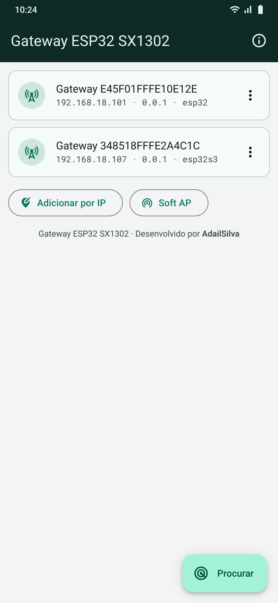
  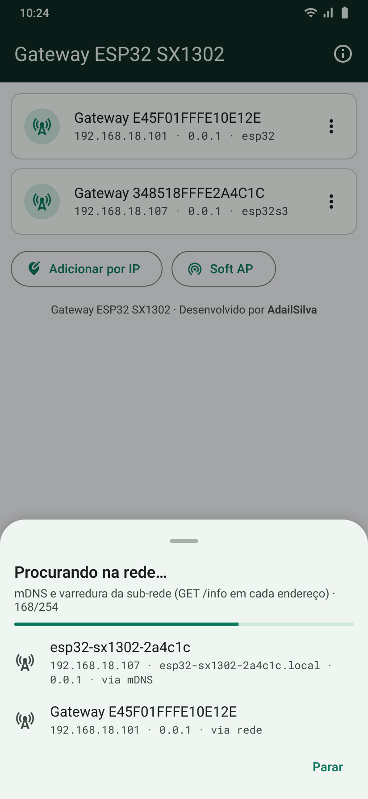
  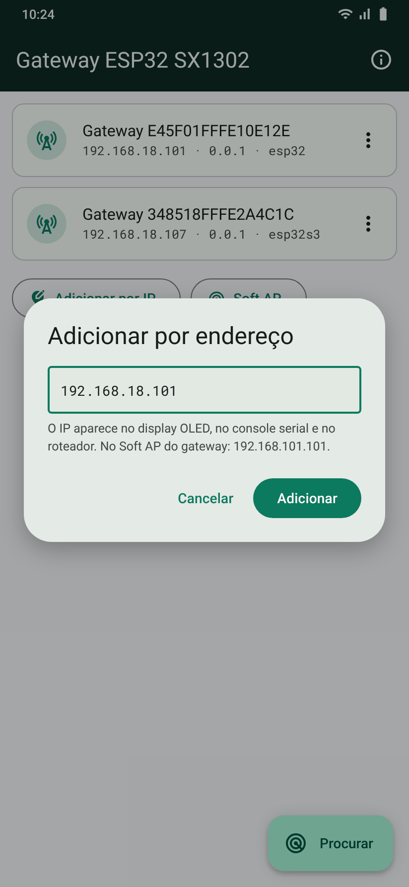
</p>

- A tela inicial mostra os gateways salvos no celular, com **IP · versão do firmware · placa** (`esp32` ou `esp32s3`). Toque em um para entrar.
- **Procurar** abre a busca: o **ESP32-S3-WROOM-2** aparece pelo **mDNS** (`esp32-sx1302-xxxxxx.local`); o **ESP32-WROOM-32U**, que não tem mDNS, é achado pela **varredura da sub-rede** (`GET /info` em cada IP). A barra mostra o progresso; toque no gateway encontrado para adicioná-lo e entrar.
- **Adicionar por IP** aceita IP, `nome.local` ou `IP:porta`. O IP aparece no display OLED, no console serial e no roteador.
- O menu **⋮** de cada gateway tem **Renomear**, **Esquecer senha** e **Remover da lista** (nada muda no gateway).

### 2. Soft AP e login

<p align="center">
  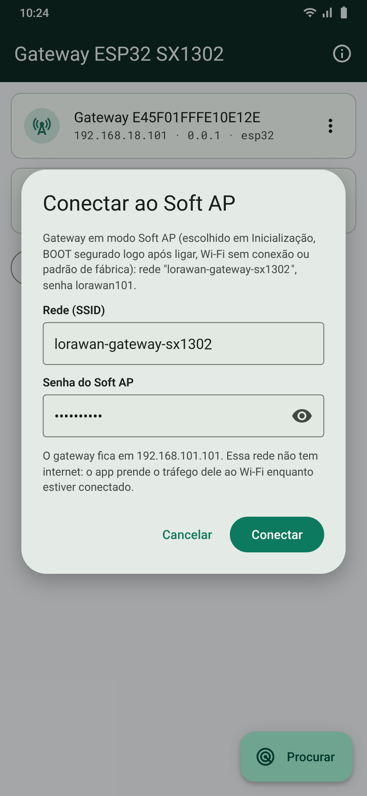
  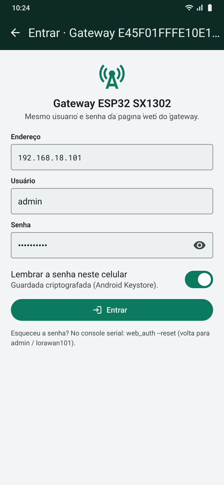
</p>

- **Soft AP:** para um gateway novo, sem Wi-Fi configurado ou com o BOOT segurado logo após ligar. O app conecta na rede **`lorawan-gateway-sx1302`** (senha **`lorawan101`**) e fala com **`192.168.101.101`**. Essa rede não tem internet: o app prende o tráfego dele ao Wi-Fi enquanto estiver conectado. Se o Android não conectar sozinho, conecte pelas configurações de Wi-Fi e toque em **Continuar**.
- **Login:** mesmo usuário e senha da página web (padrão **`admin` / `lorawan101`**). **Lembrar a senha** guarda a senha criptografada no Android Keystore. Esqueceu? No console serial, `web_auth --reset`.

### 3. Status

<p align="center">
  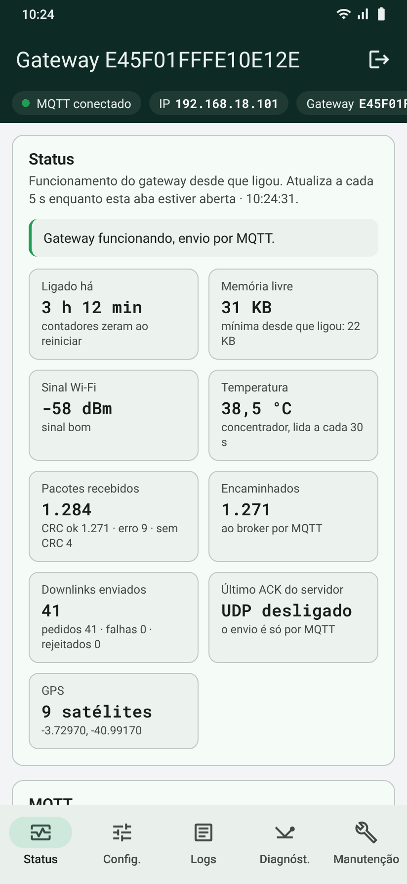
  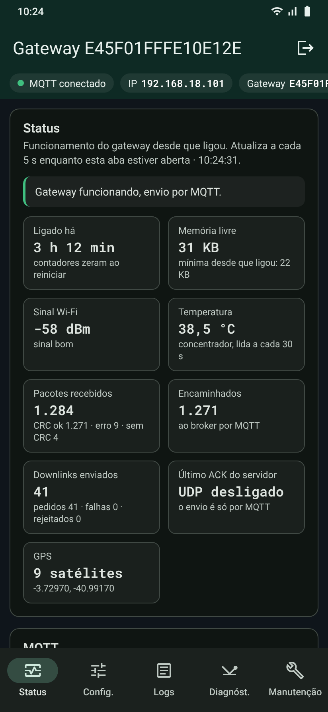
</p>

- A barra do topo mostra o estado do **MQTT**, o **IP**, o **Gateway EUI** e o **plano** de frequência. O ícone ↦ no canto sai do gateway.
- Os cartões atualizam **a cada 5 s** enquanto a aba está aberta: tempo ligado, memória livre, sinal Wi-Fi, temperatura do concentrador, pacotes recebidos e encaminhados, downlinks, último ACK do servidor (UDP) e GPS. Puxe a tela para baixo para atualizar na hora.
- O cartão **MQTT** mostra o broker, o formato, quantas mensagens e downlinks passaram e quais certificados TLS estão instalados.
- O app segue o tema claro/escuro do Android.

### 4. Configuração

<p align="center">
  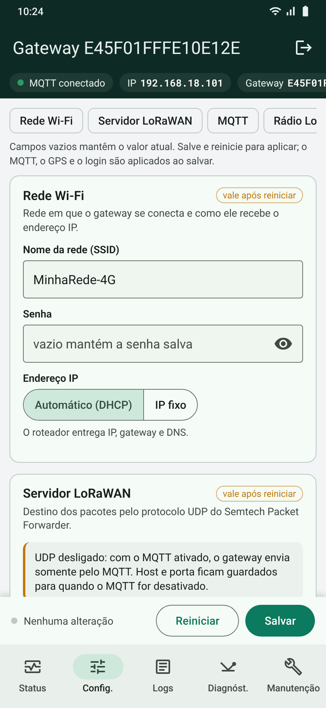
  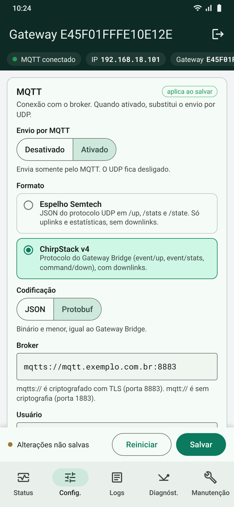
  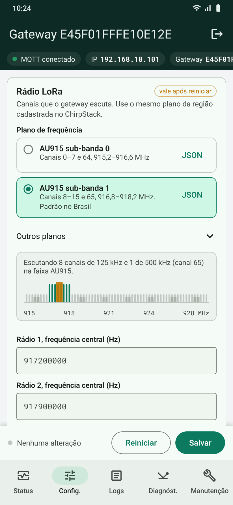
</p>

<p align="center">
  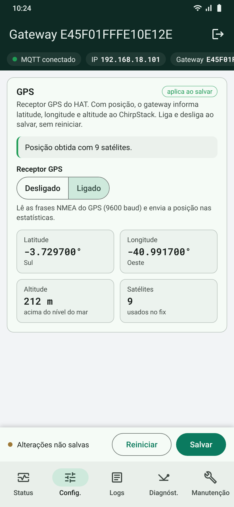
</p>

- Os botões do topo (**Rede Wi-Fi**, **Servidor LoRaWAN**, **MQTT**, **Rádio LoRa**, **GPS**, **Inicialização**, **Acesso**) levam direto à seção.
- A etiqueta de cada seção diz quando ela vale: **aplica ao salvar** (MQTT, GPS, Acesso) ou **vale após reiniciar** (Wi-Fi, servidor LoRaWAN, rádio, inicialização).
- **Rede Wi-Fi:** SSID, senha (vazia mantém a salva) e IP por DHCP ou fixo.
- **Servidor LoRaWAN:** host e porta UDP do Gateway Bridge e o **Gateway EUI**. Vazio usa o EUI automático (MAC do Wi-Fi + `FFFE`); **Automático** limpa um EUI digitado. Com o MQTT ativado, o UDP fica desligado e a seção avisa.
- **MQTT:** liga o envio, escolhe **Espelho Semtech** ou **ChirpStack v4** (JSON ou Protobuf), broker (Protocolo na lista — `mqtts://` = TLS —, Host e Porta em campos separados), usuário, senha e tópico base. Em **Certificados TLS**, cole o PEM ou escolha o arquivo e toque em **Enviar** (CA do broker, certificado e chave do cliente).
- **Rádio LoRa:** plano de frequência (**AU915 sub-banda 1** é o padrão no Brasil; **JSON** mostra o arquivo do plano), o desenho dos canais em uso e, em ajuste avançado, as frequências centrais dos dois rádios.
- **GPS:** liga e desliga o GPS do HAT sem reiniciar e mostra latitude, longitude, altitude e satélites.
- A barra de baixo avisa **Alterações não salvas**. **Salvar** grava no gateway; **Reiniciar** aplica o que só vale após reiniciar. O app valida os campos antes de enviar, com as mesmas regras da página.

### 5. Logs e Diagnósticos

<p align="center">
  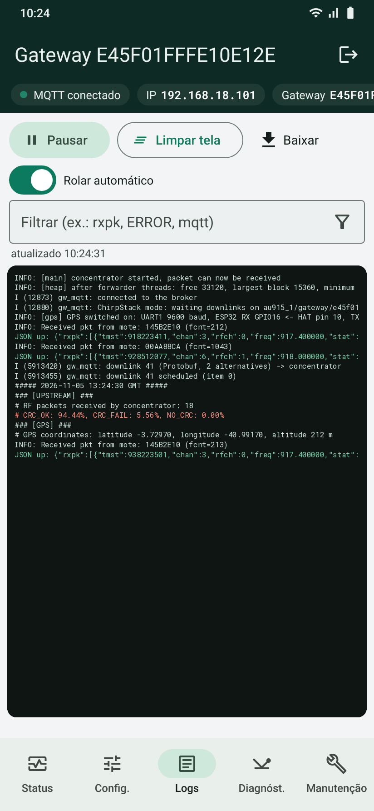
  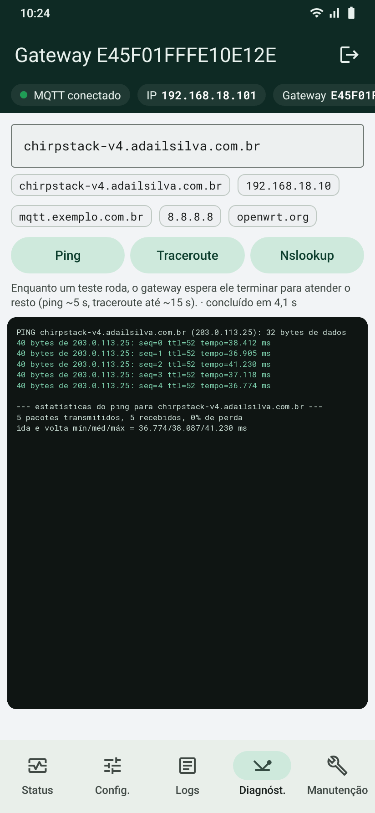
</p>

- **Logs:** tudo o que o gateway imprime no console, ao vivo. **Pausar**, **Limpar tela**, **Rolar automático**, **filtro** (ex.: `rxpk`, `ERROR`, `mqtt`) e **Baixar**: do gateway (os últimos 16 KB em RAM) ou a sessão (o que o app recebeu). Erros em vermelho, avisos em amarelo, pacotes recebidos em verde. Cada linha aparece inteira numa linha só, sem quebra: a fonte diminui (até 8) para caber e, se ainda for longa demais (ex.: `JSON up`), é só arrastar o texto para o lado. A saída do Diagnóstico funciona igual.
- **Diagnósticos:** **Ping**, **Traceroute** e **Nslookup** feitos **pelo próprio gateway**, para testar a rede dele até o servidor LoRaWAN, o broker MQTT ou a internet. O campo já vem com **`chirpstack-v4.adailsilva.com.br`** (padrão, igual à página) e os atalhos abaixo dele trazem esse domínio, o servidor LoRaWAN, o broker MQTT, `8.8.8.8` e `openwrt.org`. O resultado chega linha a linha; **Parar** interrompe.

### 6. Manutenção

<p align="center">
  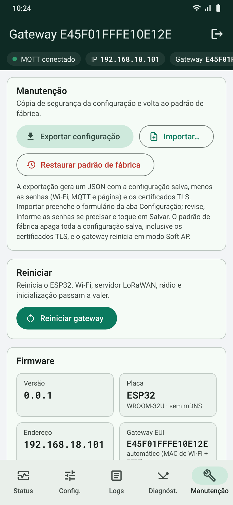
</p>

- **Exportar configuração** salva um JSON no celular (sem senhas nem certificados). **Importar…** preenche a aba Configuração com um arquivo desses; revise e toque em **Salvar**.
- **Restaurar padrão de fábrica** apaga toda a configuração (inclusive os certificados) e o gateway volta em Soft AP.
- **Reiniciar gateway** e o cartão **Firmware** (versão, placa, endereço e Gateway EUI em uso).

### 7. Classes LoRaWAN

- O ícone **🎓 Classes LoRaWAN** fica na barra superior da lista de gateways e da tela do gateway (ao lado de **Sair**).
- A tela explica o que é uma classe, as **Classes A, B e C** (quando o nó escuta, atraso do downlink, consumo, exigências e exemplos), um comparativo, **qual usar** e os campos do perfil de dispositivo no **ChirpStack v4**.
- O último cartão mostra **o que este gateway suporta hoje**, com os mesmos textos da página `/classes` e de [`doc/CLASSES_LORAWAN.md`](../doc/CLASSES_LORAWAN.md).
- Não acessa a rede: funciona mesmo sem estar logado.

## 🔌 Como o app conversa com o gateway

- **HTTP na rede local**, com o mesmo **HTTP Basic** da página (padrão de fábrica `admin` / `lorawan101`). O login é testado com `GET /config.json`: `401` = senha errada.
- **Sair** apenas apaga o login da memória do app. O truque `/logout` → `/saiu` existe só por causa do navegador.
- A senha pode ser lembrada no celular, guardada **criptografada** (Android Keystore, via `flutter_secure_storage`).
- O status é atualizado a cada **5 s**, só com a aba aberta e o app em primeiro plano. Cada pedido espera a resposta do anterior, como na página. Uma conexão keep-alive: **nenhum custo extra de RAM no ESP32**.

### Como o gateway é encontrado

| Situação | Como o app acha |
|---|---|
| Gateway **ESP32-S3-WROOM-2 (N32R16V)** na rede | **mDNS** `_http._tcp` (`http://esp32-sx1302-xxxxxx.local/`) |
| Gateway **ESP32-WROOM-32U** na rede (sem mDNS, para poupar RAM) | **Varredura da sub-rede**: `GET /info` em cada IP, 32 de cada vez, ~1 s por IP |
| Gateway em **Soft AP** | Botão **Soft AP**: rede `lorawan-gateway-sx1302`, senha `lorawan101`, gateway em `192.168.101.101` |
| Qualquer caso | **Adicionar por IP** (ou `nome.local`) |

> A busca chama `GET /info` (**sem login**: só tipo, firmware e nome, nada secreto). Firmwares antigos, sem `/info`, não aparecem na busca, mas funcionam pelo **Adicionar por IP**.

### Soft AP (rede sem internet)

A rede do Soft AP não tem internet. Nessa situação o Android manda o tráfego do app pelos **dados móveis**, e o `192.168.101.101` não responde. O `MainActivity.kt` deste app resolve isso pelo canal `lorawan/wifi`, sem plugin de terceiros:

- **Conectar ao Soft AP:** usa `WifiNetworkSpecifier` (Android 10+). O Android mostra um aviso pedindo para confirmar a rede.
- **Ao entrar:** prende o tráfego do app no Wi-Fi com `bindProcessToNetwork`. Também funciona se você conectou no Soft AP pelas configurações do Android.

## 🛠️ Compilar

Requisitos: **Flutter stable atual** (recomendado) e Android SDK (Android Studio). O mínimo é o Flutter 3.24 (Dart 3.5), mas aí é preciso um ajuste depois do `./setup.sh`: em `android/app/build.gradle`, use `compileSdk = 35`, porque `file_picker` e `nsd` exigem esse valor e o template do 3.24 gera 34. Nas versões novas do Flutter não é preciso mexer em nada.

A pasta tem só o código do app (`lib/`) e os arquivos Android que mudam (`AndroidManifest.xml`, `MainActivity.kt` e `network_security_config.xml`). O resto da estrutura Android/iOS é gerado pelo `flutter create`, **que não sobrescreve arquivos que já existem**:

```bash
cd app_flutter
./setup.sh            # = flutter create --org br.com.adailsilva --project-name esp32_sx1302_app --platforms android,ios .
                      #   + flutter pub get
flutter run           # celular conectado por USB (depuração USB ligada)
flutter build apk --release
# APK em build/app/outputs/flutter-apk/app-release.apk
```

> O pacote Android é `br.com.adailsilva.esp32_sx1302_app`. O `MainActivity.kt` já está em `android/app/src/main/kotlin/br/com/adailsilva/esp32_sx1302_app/`. Se você mudar `--org` ou `--project-name`, mova o arquivo e ajuste a linha `package`.

**Dependências:** `flutter_secure_storage` (login guardado), `nsd` (mDNS / `_http._tcp`), `file_picker` (exportar/importar configuração e logs) e `url_launcher` (links).

## 🍏 iOS (próxima etapa)

O código Dart é o mesmo. Depois do `./setup.sh`, acrescente em `ios/Runner/Info.plist`:

```xml
<key>NSLocalNetworkUsageDescription</key>
<string>Encontrar e configurar o gateway na rede Wi-Fi local.</string>
<key>NSBonjourServices</key>
<array><string>_http._tcp</string></array>
<key>NSAppTransportSecurity</key>
<dict><key>NSAllowsLocalNetworking</key><true/><key>NSAllowsArbitraryLoads</key><true/></dict>
```

No iOS, a conexão automática ao Soft AP e o `bindProcessToNetwork` ainda não estão implementados (o canal não existe e o app segue sem eles). Conecte no Soft AP pelos Ajustes. O iOS já usa o Wi-Fi para endereços locais.

## 📁 Estrutura

```
app_flutter/
├── lib/
│   ├── main.dart                 # tipo do app (flavor) e tema
│   ├── core/                     # HTTP + Basic, sessão (status a cada 5 s), descoberta,
│   │                             # Wi-Fi/Soft AP, arquivos, formatação e validação
│   ├── ui/                       # lista de dispositivos, login, logs, componentes comuns,
│   │                             # lorawan_classes_screen.dart (tela Classes LoRaWAN)
│   └── gateway/                  # status, configuração, diagnósticos, manutenção, regras da página
├── android/app/src/main/         # AndroidManifest, MainActivity.kt (canal lorawan/wifi),
│                                 # res/xml/network_security_config.xml (HTTP na rede local)
├── test/format_test.dart
├── setup.sh
└── pubspec.yaml
```

---

<p align="center">Gateway ESP32 with SX1302 · Desenvolvido por <a href="https://k8s.adailsilva.com.br/"><b>AdailSilva</b></a></p>
