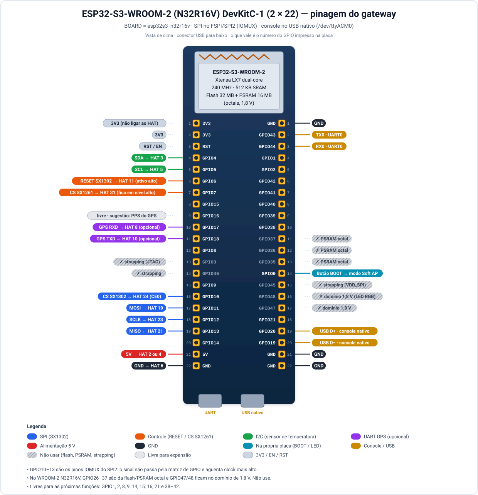
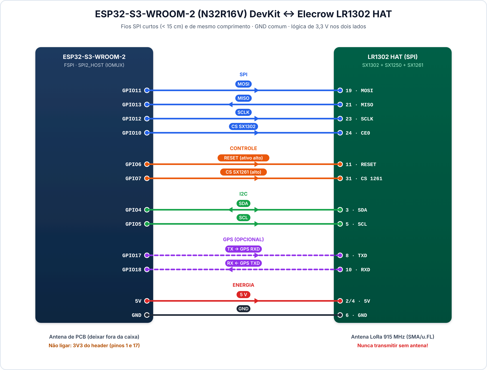
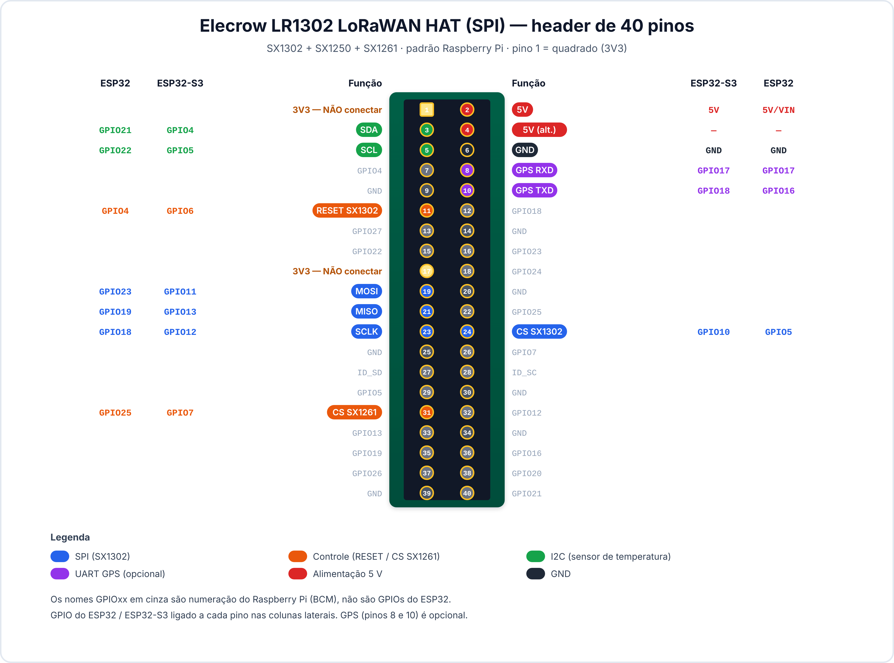
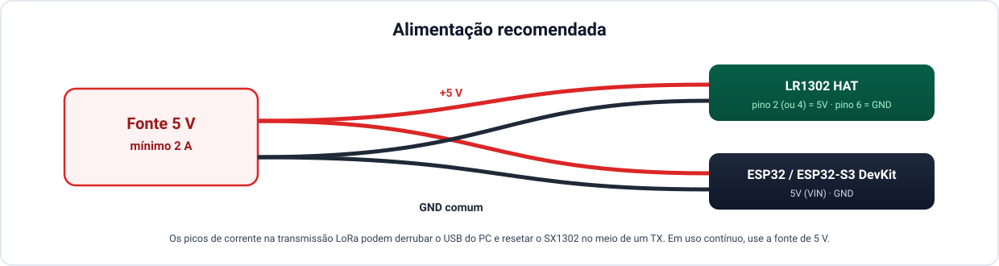

# Ligações: ESP32-S3-WROOM-2-N32R16V DevKit ↔ Elecrow LR1302 LoRaWAN HAT (SPI)

Placa **`BOARD=esp32s3_n32r16v`** (alvo `esp32s3`; nome antigo do build: `esp32s3`). Módulo com a marcação **MCN32R16V** na blindagem. É a pinagem compilada pelo bloco `if(IDF_TARGET STREQUAL "esp32s3")` de [`main/CMakeLists.txt`](../../main/CMakeLists.txt), a mesma do [ESP32-S3-WROOM-1U-N16R8](ESP32-S3-WROOM-1U_N16R8_DevKit.md). Comparação das três placas: [README desta pasta](README.md).

| Item | Valor |
|---|---|
| Chip | ESP32-S3R16V, Xtensa LX7 dual-core 240 MHz, 512 KB SRAM |
| Flash | **32 MB octal (OPI), 1,8 V** |
| PSRAM | **16 MB octal, 1,8 V** |
| Antena Wi-Fi | de PCB (não tem u.FL) |
| Console | USB nativo (USB-Serial/JTAG, GPIO19/20) → `/dev/ttyACM0` |
| Arquivos do build | `sdkconfig.defaults` + `sdkconfig.defaults.esp32s3` + [`boards/esp32s3_n32r16v.defaults`](../../boards/esp32s3_n32r16v.defaults) + [`partitions_esp32s3.csv`](../../partitions_esp32s3.csv) |
| Build | `./scripts/build.sh esp32s3_n32r16v` → `build-esp32s3_n32r16v/` + `sdkconfig.esp32s3_n32r16v` |

> **Referência dos lados:**
> - **ESP32-S3:** layout da ESP32-S3-DevKitC-1 (2 × 22 pinos), vista de cima, com os conectores USB para baixo. Placas genéricas podem ter outra ordem física, mas **o que vale é o número do GPIO** impresso na placa.
> - **HAT:** o header de 40 pinos segue o padrão do Raspberry Pi. O pino 1 é o quadrado, marcado "1"/"3V3".
>
> **Por que esses GPIOs** (módulo **WROOM-2 N32R16V**, com flash e PSRAM octais em **1,8 V**):
> - **GPIO26–32:** flash.
> - **GPIO33–37:** PSRAM octal.
> - **GPIO47/48:** ficam no domínio de 1,8 V; não ligar sinais de 3,3 V.
> - **GPIO19/20:** USB nativo, onde fica o console.
> - **GPIO43/44:** UART0.
> - **GPIO0/3/45/46:** strapping.
>
> A pinagem abaixo evita todos eles.

<p align="center"></p>
<p align="center">
  <a href="../images/wiring_esp32s3_wroom2.png"></a>
</p>
<p align="center"><sub>🔍 Alta resolução (PNG, 3720 px de largura): clique na imagem para ampliar · versão vetorial: <a href="../images/wiring_esp32s3_wroom2.svg"><code>wiring_esp32s3_wroom2.svg</code></a></sub></p>

---

## 1. Tabela de ligações

| # | Sinal | ESP32-S3 (GPIO) | Sentido | HAT (pino físico) | Nome no padrão RPi |
|---|-------|-----------------|:-------:|-------------------|--------------------|
| 1 | SPI MOSI | **GPIO11** | → | **19** | GPIO10 / MOSI |
| 2 | SPI MISO | **GPIO13** | ← | **21** | GPIO9 / MISO |
| 3 | SPI SCLK | **GPIO12** | → | **23** | GPIO11 / SCLK |
| 4 | CS do SX1302 | **GPIO10** | → | **24** | GPIO8 / CE0 |
| 5 | RESET do SX1302 (ativo em nível alto) | **GPIO6** | → | **11** | GPIO17 |
| 6 | CS do SX1261 (fica sempre em nível alto) | **GPIO7** | → | **31** | GPIO6 |
| 7 | I2C SDA (sensor de temperatura / OLED) | **GPIO4** | ↔ | **3** | GPIO2 / SDA |
| 8 | I2C SCL | **GPIO5** | → | **5** | GPIO3 / SCL |
| 9 | GPS RX do HAT *(opcional)* | **GPIO17** (TX) | → | **8** | GPIO14 / TXD |
| 10 | GPS TX do HAT *(opcional)* | **GPIO18** (RX) | ← | **10** | GPIO15 / RXD |
| 11 | Alimentação 5 V | **5V** | → | **2** e/ou **4** | 5V |
| 12 | Terra | **GND** | — | **6** (e 9, 14, 20, 25…) | GND |

**SPI:** GPIO10–13 são os pinos nativos (IOMUX) do FSPI/SPI2 do S3 (`SX1302_SPI_HOST=SPI2_HOST`). Com eles o sinal não passa pela matriz de GPIO e aguenta clock mais alto.

**Não ligar:**
- **3V3 do header (pinos 1 e 17).** O HAT gera os próprios 3,3 V a partir dos 5 V.
- **POWER_EN.** O LR1302 HAT não tem essa linha (`SX1302_POWER_EN_PIN=GPIO_NUM_NC`).

**Já na placa, sem fio extra:**
- **GPIO0:** botão BOOT. Se estiver pressionado logo após o reset, o gateway entra em modo Soft AP.
- **LED:** o LED da DevKit é RGB (WS2812), por isso `BLINK_GPIO=GPIO_NUM_NC`. Em algumas DevKits ele fica no GPIO48, que neste módulo está no domínio de 1,8 V.

**Livres para expansão** (LED de status, botão, PPS do GPS etc.): GPIO1, 2, 8, 9, 14, 15, 16, 21, 38–42.

---

## 2. Pinout da ESP32-S3-DevKitC-1 (2 × 22) em texto

```
                        ┌─────────────────────────┐
                        │  ESP32-S3-WROOM-2       │
                        │  N32R16V (antena PCB)   │
                   ┌────┴─────────────────────────┴────┐
            3V3 ───┤ 1                               1 ├─── GND ◄────────── GND (HAT 6)
            3V3 ───┤ 2                               2 ├─── GPIO43 (TX0)
            RST ───┤ 3                               3 ├─── GPIO44 (RX0)
SDA  (HAT 3) ►GPIO4┤ 4                               4 ├─── GPIO1
SCL  (HAT 5) ►GPIO5┤ 5                               5 ├─── GPIO2
RESET(HAT11) ►GPIO6┤ 6                               6 ├─── GPIO42
CS1261(HAT31)►GPIO7┤ 7                               7 ├─── GPIO41
         GPIO15 ───┤ 8                               8 ├─── GPIO40
         GPIO16 ───┤ 9                               9 ├─── GPIO39
GPS RXD(HAT 8)►G17 ┤ 10                             10 ├─── GPIO38
GPS TXD(HAT10)►G18 ┤ 11                             11 ├─── GPIO37 (PSRAM) ✗
          GPIO8 ───┤ 12                             12 ├─── GPIO36 (PSRAM) ✗
        ✗ GPIO3 ───┤ 13  (strapping)                13 ├─── GPIO35 (PSRAM) ✗
       ✗ GPIO46 ───┤ 14  (strapping)                14 ├─── GPIO0  (botão BOOT → Soft AP)
          GPIO9 ───┤ 15                             15 ├─── GPIO45 (strapping) ✗
CS SX1302(24)►G10  ┤ 16                             16 ├─── GPIO48 (1,8 V!) ✗
MOSI (HAT19) ►G11  ┤ 17                             17 ├─── GPIO47 (1,8 V!) ✗
SCLK (HAT23) ►G12  ┤ 18                             18 ├─── GPIO21
MISO (HAT21) ►G13  ┤ 19                             19 ├─── GPIO20 (USB D+) ✗
         GPIO14 ───┤ 20                             20 ├─── GPIO19 (USB D−) ✗
  5V ◄─────────────┤ 21                             21 ├─── GND
  └─► HAT 2/4  GND ┤ 22                             22 ├─── GND
                   └──────[ USB-UART ]────[ USB nativo ]──┘
                                          (console /dev/ttyACM0)

  ► = pino usado pelo gateway       ✗ = não usar
```

---

## 3. Header do HAT

<p align="center">
  <a href="../images/lr1302_hat_header.png"></a>
</p>
<p align="center"><sub>🔍 Alta resolução (PNG, 3720 px de largura): clique na imagem para ampliar · versão vetorial: <a href="../images/lr1302_hat_header.svg"><code>lr1302_hat_header.svg</code></a></sub></p>

---

## 4. Alimentação

<p align="center"></p>

- A transmissão LoRa gera **picos de corrente**. Em uso contínuo, alimente pelos **5 V de uma fonte de 2 A**, não só pelo USB.
- **O GND precisa ser comum** a tudo.
- A lógica do HAT é **3,3 V**. Todos os GPIOs usados (4–7, 10–13, 17, 18) são de 3,3 V no S3, então não precisa de conversor de nível.

---

## 5. Configuração do firmware para este módulo

O [`boards/esp32s3_n32r16v.defaults`](../../boards/esp32s3_n32r16v.defaults) traz as opções do **WROOM-2 N32R16V**. Sem elas o módulo não inicia, porque a flash e a PSRAM são **octais**:

```
CONFIG_GW_BOARD_ESP32S3_WROOM_2_N32R16V=y
CONFIG_ESPTOOLPY_OCT_FLASH=y            # flash octal (OPI)
CONFIG_ESPTOOLPY_FLASHFREQ_80M=y
CONFIG_ESPTOOLPY_FLASHSIZE_32MB=y
CONFIG_SPIRAM=y
CONFIG_SPIRAM_MODE_OCT=y                # PSRAM octal
CONFIG_SPIRAM_SPEED_80M=y
CONFIG_SPIRAM_USE_MALLOC=y
```

Do [`sdkconfig.defaults.esp32s3`](../../sdkconfig.defaults.esp32s3), comum aos dois S3:

```
CONFIG_ESP_CONSOLE_USB_SERIAL_JTAG=y    # console no USB nativo (/dev/ttyACM0)
CONFIG_PARTITION_TABLE_CUSTOM=y         # partitions_esp32s3.csv: app de 4 MB em 0x10000
```

Mover a sessão TLS e as filas para a PSRAM fica para a próxima etapa (veja o roadmap no README).

Com o ESP-IDF já ativado (instalação no Linux, macOS ou Windows: seção [Preparar o ambiente ESP-IDF](../../README.md#-preparar-o-ambiente-esp-idf) do README):

```bash
./scripts/build.sh esp32s3_n32r16v                     # só compila
./scripts/build.sh esp32s3_n32r16v flash /dev/ttyACM0  # porta "USB" (nativa), não a "UART"
./scripts/build.sh esp32s3_n32r16v monitor /dev/ttyACM0
```

**Com log em `logs/`** (Linux/WSL2; os mesmos comandos de [Gravar e acompanhar o log](../../README.md#gravar-e-acompanhar-o-log) do README). Porta desta placa: `/dev/ttyACM0`, porta USB nativa. **Do zero** apaga a configuração; **Atualizar** mantém a configuração.

**Do zero:** apaga a flash, compila do zero, grava e abre o monitor

```bash
sudo fuser -k /dev/ttyACM0 2>/dev/null ; \
cd ~/Apps/esp-idf/ && \
. ./export.sh && \
cd ~/Apps/lorawan_workspace/Gateway_ESP32_SX1302_LR1302_HAT_Elecrow && \
mkdir -p logs && \
LOG=logs/esp32s3_n32r16v_$(date +%Y%m%d_%H%M%S).log && \
script -f -q -c "rm -rf build-esp32s3_n32r16v sdkconfig.esp32s3_n32r16v managed_components dependencies.lock && sh scripts/build.sh esp32s3_n32r16v erase /dev/ttyACM0 && sh scripts/build.sh esp32s3_n32r16v flash /dev/ttyACM0" "$LOG" ; \
sed -r 's/\x1B\[[0-9;]*[mK]//g; s/\r//g' "$LOG" > "${LOG%.log}_limpo.log" && \
echo "Logs salvos em: $LOG e ${LOG%.log}_limpo.log"
```

**Atualizar:** compila do zero, grava e abre o monitor (mantém a configuração)

```bash
sudo fuser -k /dev/ttyACM0 2>/dev/null ; \
cd ~/Apps/esp-idf/ && \
. ./export.sh && \
cd ~/Apps/lorawan_workspace/Gateway_ESP32_SX1302_LR1302_HAT_Elecrow && \
mkdir -p logs && \
LOG=logs/esp32s3_n32r16v_update_$(date +%Y%m%d_%H%M%S).log && \
script -f -q -c "rm -rf build-esp32s3_n32r16v sdkconfig.esp32s3_n32r16v managed_components dependencies.lock && sh scripts/build.sh esp32s3_n32r16v flash /dev/ttyACM0" "$LOG" ; \
sed -r 's/\x1B\[[0-9;]*[mK]//g; s/\r//g' "$LOG" > "${LOG%.log}_limpo.log" && \
echo "Logs salvos em: $LOG e ${LOG%.log}_limpo.log"
```

**Só monitorar:** sem compilar nem gravar

```bash
sudo fuser -k /dev/ttyACM0 2>/dev/null ; \
cd ~/Apps/esp-idf/ && \
. ./export.sh && \
cd ~/Apps/lorawan_workspace/Gateway_ESP32_SX1302_LR1302_HAT_Elecrow && \
mkdir -p logs && \
LOG=logs/esp32s3_n32r16v_monitor_$(date +%Y%m%d_%H%M%S).log && \
script -f -q -c "sh scripts/build.sh esp32s3_n32r16v monitor /dev/ttyACM0" "$LOG" ; \
sed -r 's/\x1B\[[0-9;]*[mK]//g; s/\r//g' "$LOG" > "${LOG%.log}_limpo.log" && \
echo "Logs salvos em: $LOG e ${LOG%.log}_limpo.log"
```

Sem o script (Windows nativo):

```powershell
idf.py -B build-esp32s3_n32r16v -D SDKCONFIG=sdkconfig.esp32s3_n32r16v -D IDF_TARGET=esp32s3 -D BOARD=esp32s3_n32r16v build
idf.py -B build-esp32s3_n32r16v -D SDKCONFIG=sdkconfig.esp32s3_n32r16v -D IDF_TARGET=esp32s3 -D BOARD=esp32s3_n32r16v -p COM6 flash monitor
```

Binário pronto da Release: `Gateway_ESP32_SX1302_LR1302_HAT_Elecrow-<versão>-esp32s3_n32r16v-full.bin` (gravar em `0x0`).

> **Não grave o firmware do N16R8 neste módulo.** O N16R8 usa flash quad de 3,3 V; com ele o N32R16V não inicia.

---

## 6. Observações

1. **Fios SPI curtos**, idealmente com menos de 10–15 cm e de mesmo comprimento.
2. **CS do SX1261 (GPIO7 → pino 31):** o firmware mantém esse pino em nível **alto** antes do reset do SX1302, para o SX1261 não disputar o barramento SPI. Não deixe esse fio solto.
3. **RESET (GPIO6 → pino 11)** é ativo em **nível alto**. O firmware gera o pulso sozinho no boot.
4. **Sensor de temperatura:** o módulo LR1302 tem um **STTS751**, ligado aos pinos 3 (SDA) e 5 (SCL) do HAT. O firmware procura o sensor nos 8 endereços possíveis (0x38–0x3B, 0x48–0x4B). Se nenhum responder, usa 25 °C na compensação de RSSI e mostra no boot o que respondeu no I2C. O HAT **não tem pull-ups** (no Raspberry Pi eles ficam na placa do Pi). Se nada responder, ligue **4,7 kΩ do SDA (GPIO4) e do SCL (GPIO5) ao 3,3 V**.
5. **GPS:** depois de ligar os pinos 8/10, ative o GPS na página web (seção **GPS**, aplicado ao salvar, sem reiniciar) ou no console com `gps on`. O PPS ainda não está mapeado no firmware. Se for usar, ligue o PPS do HAT a um GPIO livre, por exemplo GPIO16 ou GPIO21.
8. **Conferência no boot:** o monitor mostra `*** Board: ESP32-S3-WROOM-2-N32R16V (esp32s3_n32r16v, esp32s3) ***` logo depois da versão. Se aparecer outro nome, o firmware gravado é de outra placa.
6. **Antena Wi-Fi:** o WROOM-2 só tem antena de PCB. Deixe a ponta do módulo, onde fica a antena, para fora da caixa e longe do HAT e de partes metálicas.
7. **Antena LoRa:** nunca ligue o gateway sem antena no conector LoRa do HAT.
