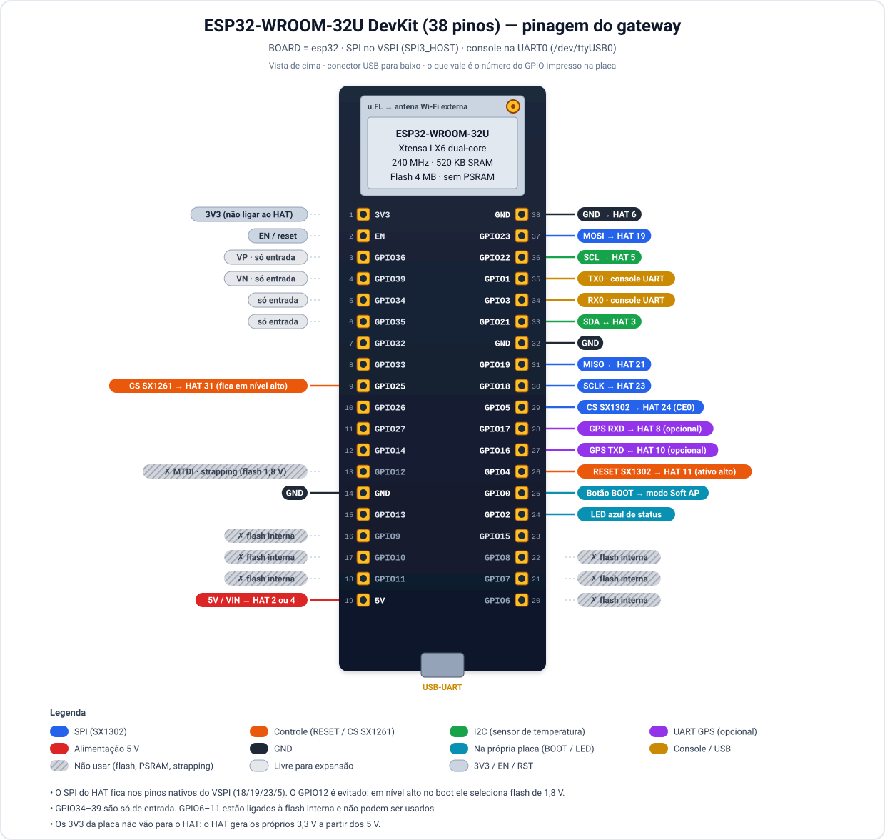
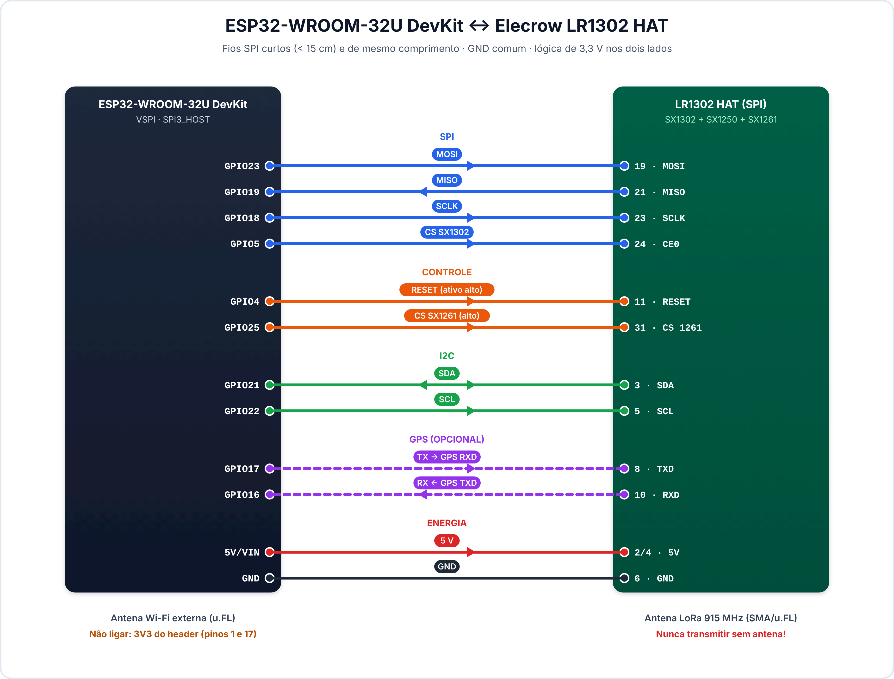
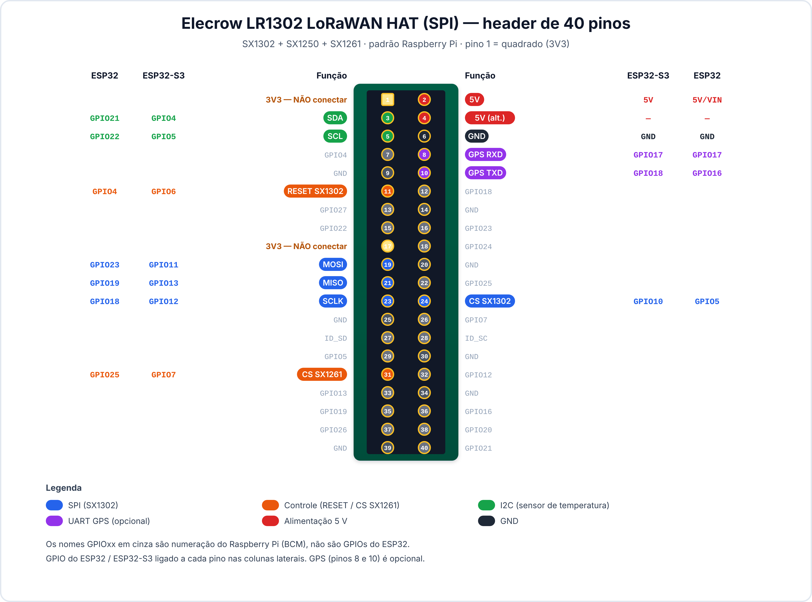
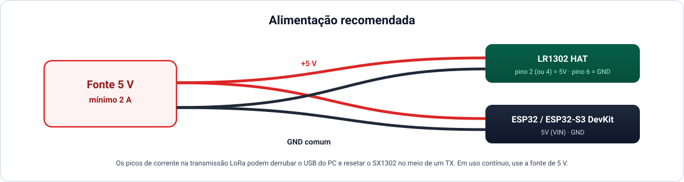

# Ligações: ESP32-WROOM-32U DevKit ↔ Elecrow LR1302 LoRaWAN HAT (SPI)

Placa **`BOARD=esp32`** (alvo `esp32`). É a pinagem compilada pelo bloco `elseif(IDF_TARGET STREQUAL "esp32")` de [`main/CMakeLists.txt`](../../main/CMakeLists.txt). Comparação das três placas: [README desta pasta](README.md).

| Item | Valor |
|---|---|
| Chip | ESP32-D0WD-V3, Xtensa LX6 dual-core 240 MHz, 520 KB SRAM |
| Flash | 4 MB quad, 3,3 V (GPIO6–11) |
| PSRAM | não tem |
| Antena Wi-Fi | externa, conector u.FL |
| Console | UART0 (chip USB-UART da DevKit) → `/dev/ttyUSB0` |
| Arquivos do build | `sdkconfig.defaults` + [`sdkconfig.defaults.esp32`](../../sdkconfig.defaults.esp32) + [`boards/esp32.defaults`](../../boards/esp32.defaults) (tabela `partitions_singleapp_large.csv`, app de 1,5 MB) |
| Build | `./scripts/build.sh esp32` → `build-esp32/` + `sdkconfig.esp32` |

> **Referência dos lados:**
> - **ESP32:** DevKitC de 38 pinos (ESP32-WROOM-32U, com conector u.FL), vista de cima e com o USB para baixo. DevKits de 30 pinos têm outra ordem física, mas **o que vale é o número do GPIO** impresso na placa.
> - **HAT:** o header de 40 pinos segue o padrão do Raspberry Pi. O pino 1 é o quadrado, marcado "1"/"3V3".

<p align="center"></p>
<p align="center">
  <a href="../images/wiring_esp32_wroom32u.png"></a>
</p>
<p align="center"><sub>🔍 Alta resolução (PNG, 3720 px de largura): clique na imagem para ampliar · versão vetorial: <a href="../images/wiring_esp32_wroom32u.svg"><code>wiring_esp32_wroom32u.svg</code></a></sub></p>

---

## 1. Tabela de ligações

| # | Sinal | ESP32 (GPIO) | Sentido | HAT (pino físico) | Nome no padrão RPi |
|---|-------|--------------|:-------:|-------------------|--------------------|
| 1 | SPI MOSI | **GPIO23** | → | **19** | GPIO10 / MOSI |
| 2 | SPI MISO | **GPIO19** | ← | **21** | GPIO9 / MISO |
| 3 | SPI SCLK | **GPIO18** | → | **23** | GPIO11 / SCLK |
| 4 | CS do SX1302 | **GPIO5** | → | **24** | GPIO8 / CE0 |
| 5 | RESET do SX1302 (ativo em nível alto) | **GPIO4** | → | **11** | GPIO17 |
| 6 | CS do SX1261 (fica sempre em nível alto) | **GPIO25** | → | **31** | GPIO6 |
| 7 | I2C SDA (sensor de temperatura / OLED) | **GPIO21** | ↔ | **3** | GPIO2 / SDA |
| 8 | I2C SCL | **GPIO22** | → | **5** | GPIO3 / SCL |
| 9 | GPS RX do HAT *(opcional)* | **GPIO17** (TX) | → | **8** | GPIO14 / TXD |
| 10 | GPS TX do HAT *(opcional)* | **GPIO16** (RX) | ← | **10** | GPIO15 / RXD |
| 11 | Alimentação 5 V | **5V / VIN** | → | **2** e/ou **4** | 5V |
| 12 | Terra | **GND** | — | **6** (e 9, 14, 20, 25…) | GND |

**Não ligar:**
- **3V3 do header (pinos 1 e 17).** O HAT gera os próprios 3,3 V a partir dos 5 V.
- **POWER_EN.** O LR1302 HAT não tem essa linha (`SX1302_POWER_EN_PIN=GPIO_NUM_NC`).

**Já na placa, sem fio extra:**
- **GPIO0:** botão BOOT. Se estiver pressionado logo após o reset, o gateway entra em modo Soft AP.
- **GPIO2:** LED azul da DevKit (`BLINK_GPIO=2`).

**Pinos que não devem ser usados:**
- **GPIO6 a GPIO11:** ligados à flash SPI interna.
- **GPIO12 (MTDI):** pino de strapping. Se estiver em nível alto no boot, seleciona flash de 1,8 V e o ESP32 não inicia. Por isso o SPI do HAT fica nos pinos nativos do VSPI (18/19/23/5).
- **GPIO34 a GPIO39:** só funcionam como entrada.

---

## 2. Pinout da DevKitC (38 pinos) em texto

```
                         ┌───────────────────┐
                         │   ESP32-WROOM-32U │
                         │   (antena u.FL)   │
                    ┌────┴───────────────────┴────┐
              3V3 ──┤ 1                       38 ├── GND ◄──────── GND (HAT 6)
               EN ──┤ 2                       37 ├── GPIO23 ◄───── MOSI (HAT 19)
     GPIO36 (VP) ───┤ 3                       36 ├── GPIO22 ◄───── SCL  (HAT 5)
     GPIO39 (VN) ───┤ 4                       35 ├── GPIO1  (TX0 / console)
           GPIO34 ──┤ 5                       34 ├── GPIO3  (RX0 / console)
           GPIO35 ──┤ 6                       33 ├── GPIO21 ◄───── SDA  (HAT 3)
           GPIO32 ──┤ 7                       32 ├── GND
           GPIO33 ──┤ 8                       31 ├── GPIO19 ◄───── MISO (HAT 21)
 CS SX1261 ► GPIO25 ┤ 9                       30 ├── GPIO18 ◄───── SCLK (HAT 23)
           GPIO26 ──┤ 10                      29 ├── GPIO5  ◄───── CS SX1302 (HAT 24)
           GPIO27 ──┤ 11                      28 ├── GPIO17 ◄───── GPS RXD (HAT 8)   [opcional]
           GPIO14 ──┤ 12                      27 ├── GPIO16 ◄───── GPS TXD (HAT 10)  [opcional]
  ✗ GPIO12 (MTDI) ──┤ 13                      26 ├── GPIO4  ◄───── RESET SX1302 (HAT 11)
              GND ──┤ 14                      25 ├── GPIO0  (botão BOOT → Soft AP)
           GPIO13 ──┤ 15                      24 ├── GPIO2  (LED azul)
  ✗ GPIO9  (flash) ─┤ 16                      23 ├── GPIO15
  ✗ GPIO10 (flash) ─┤ 17                      22 ├── GPIO8  (flash) ✗
  ✗ GPIO11 (flash) ─┤ 18                      21 ├── GPIO7  (flash) ✗
   5V (VIN) ◄───────┤ 19                      20 ├── GPIO6  (flash) ✗
   └─► HAT 2/4      └─────────────[ USB ]─────────┘

  ◄── = pino usado pelo gateway       ✗ = não usar
```

---

## 3. Header do HAT

<p align="center">
  <a href="../images/lr1302_hat_header.png"></a>
</p>
<p align="center"><sub>🔍 Alta resolução (PNG, 3720 px de largura): clique na imagem para ampliar · versão vetorial: <a href="../images/lr1302_hat_header.svg"><code>lr1302_hat_header.svg</code></a></sub></p>

---

## 4. Alimentação

<p align="center"></p>

- A transmissão LoRa (SX1250 com PA) gera **picos de corrente**. Só o USB do PC pode derrubar a tensão e resetar o SX1302 no meio de um TX. Em uso contínuo, alimente pelos **5 V de uma fonte de 2 A**.
- No desenvolvimento, dá para alimentar tudo pelo USB da DevKit (o 5V/VIN segue para o HAT). Se aparecer reset ou brownout ao transmitir, a causa é a alimentação.
- **O GND precisa ser comum** a tudo.
- A lógica do HAT é **3,3 V**, compatível direto com o ESP32, sem conversor de nível.

---

## 5. Observações

1. **Fios SPI curtos**, idealmente com menos de 10–15 cm e de mesmo comprimento. Jumpers longos causam erros de leitura do SX1302 (`failed to start the concentrator`). Se for usar fios longos, reduza o clock SPI.
2. **CS do SX1261 (GPIO25 → pino 31):** o SX1261 (LBT / spectral scan) divide o barramento SPI. O firmware mantém esse pino em nível **alto** antes do reset do SX1302, para que o SX1261 não responda no lugar dele. Não deixe esse fio solto.
3. **RESET (GPIO4 → pino 11)** é ativo em **nível alto**. O firmware gera o pulso sozinho no boot (`lgw_reset()`).
4. **Sensor de temperatura (I2C):** o módulo LR1302 tem um **STTS751**, ligado aos pinos 3 (SDA) e 5 (SCL) do HAT. O firmware procura o sensor nos 8 endereços possíveis (0x38–0x3B, 0x48–0x4B). Se nenhum responder, usa 25 °C na compensação de RSSI e faz uma varredura do I2C no boot (`devices on the bus: ...` ou `no device answers on the I2C bus`). O HAT **não tem pull-ups**: no Raspberry Pi eles ficam na placa do Pi (1,8 kΩ). Se nada responder, ligue **4,7 kΩ do SDA (GPIO21) e do SCL (GPIO22) ao 3,3 V** do ESP32.
5. **GPS:** ligue os pinos 8/10 e ative o GPS na página web (seção **GPS**, aplicado ao salvar, sem reiniciar) ou no console com `gps on`. A seção mostra latitude, longitude, satélites e as frases NMEA recebidas. O PPS ainda não está mapeado no firmware.
6. **Console:** GPIO1/GPIO3 (UART0) ficam livres para o `idf.py monitor` e o prompt `ESP32_SX1302>`.
7. **Antena LoRa:** nunca ligue o gateway sem antena no conector LoRa do HAT. Um downlink sem carga pode danificar o PA.

---

## 6. Compilar e gravar

Opções deste módulo, em [`boards/esp32.defaults`](../../boards/esp32.defaults) e [`sdkconfig.defaults.esp32`](../../sdkconfig.defaults.esp32):

```
CONFIG_GW_BOARD_ESP32_WROOM_32U=y
CONFIG_ESPTOOLPY_FLASHMODE_DIO=y
CONFIG_ESPTOOLPY_FLASHFREQ_40M=y
CONFIG_ESPTOOLPY_FLASHSIZE_4MB=y
CONFIG_ESP_WIFI_STATIC_RX_BUFFER_NUM=6       # RAM para o handshake TLS (sem PSRAM)
# CONFIG_ESP_WIFI_AMPDU_RX_ENABLED is not set
```

Com o ESP-IDF já ativado (instalação no Linux, macOS ou Windows: seção [Preparar o ambiente ESP-IDF](../../README.md#-preparar-o-ambiente-esp-idf) do README):

```bash
./scripts/build.sh esp32                       # só compila
./scripts/build.sh esp32 flash /dev/ttyUSB0    # grava e abre o monitor
./scripts/build.sh esp32 monitor /dev/ttyUSB0
```

**Com log em `logs/`** (Linux/WSL2; os mesmos comandos de [Gravar e acompanhar o log](../../README.md#gravar-e-acompanhar-o-log) do README). Porta desta placa: `/dev/ttyUSB0`. **Do zero** apaga a configuração; **Atualizar** mantém a configuração.

**Do zero:** apaga a flash, compila do zero, grava e abre o monitor

```bash
sudo fuser -k /dev/ttyUSB0 2>/dev/null ; \
cd ~/Apps/esp-idf/ && \
. ./export.sh && \
cd ~/Apps/lorawan_workspace/Gateway_ESP32_SX1302_LR1302_HAT_Elecrow && \
mkdir -p logs && \
LOG=logs/esp32_$(date +%Y%m%d_%H%M%S).log && \
script -f -q -c "rm -rf build-esp32 sdkconfig.esp32 managed_components dependencies.lock && sh scripts/build.sh esp32 erase /dev/ttyUSB0 && sh scripts/build.sh esp32 flash /dev/ttyUSB0" "$LOG" ; \
sed -r 's/\x1B\[[0-9;]*[mK]//g; s/\r//g' "$LOG" > "${LOG%.log}_limpo.log" && \
echo "Logs salvos em: $LOG e ${LOG%.log}_limpo.log"
```

**Atualizar:** compila do zero, grava e abre o monitor (mantém a configuração)

```bash
sudo fuser -k /dev/ttyUSB0 2>/dev/null ; \
cd ~/Apps/esp-idf/ && \
. ./export.sh && \
cd ~/Apps/lorawan_workspace/Gateway_ESP32_SX1302_LR1302_HAT_Elecrow && \
mkdir -p logs && \
LOG=logs/esp32_update_$(date +%Y%m%d_%H%M%S).log && \
script -f -q -c "rm -rf build-esp32 sdkconfig.esp32 managed_components dependencies.lock && sh scripts/build.sh esp32 flash /dev/ttyUSB0" "$LOG" ; \
sed -r 's/\x1B\[[0-9;]*[mK]//g; s/\r//g' "$LOG" > "${LOG%.log}_limpo.log" && \
echo "Logs salvos em: $LOG e ${LOG%.log}_limpo.log"
```

**Só monitorar:** sem compilar nem gravar

```bash
sudo fuser -k /dev/ttyUSB0 2>/dev/null ; \
cd ~/Apps/esp-idf/ && \
. ./export.sh && \
cd ~/Apps/lorawan_workspace/Gateway_ESP32_SX1302_LR1302_HAT_Elecrow && \
mkdir -p logs && \
LOG=logs/esp32_monitor_$(date +%Y%m%d_%H%M%S).log && \
script -f -q -c "sh scripts/build.sh esp32 monitor /dev/ttyUSB0" "$LOG" ; \
sed -r 's/\x1B\[[0-9;]*[mK]//g; s/\r//g' "$LOG" > "${LOG%.log}_limpo.log" && \
echo "Logs salvos em: $LOG e ${LOG%.log}_limpo.log"
```

Sem o script (Windows nativo):

```powershell
idf.py -B build-esp32 -D SDKCONFIG=sdkconfig.esp32 -D IDF_TARGET=esp32 -D BOARD=esp32 build
idf.py -B build-esp32 -D SDKCONFIG=sdkconfig.esp32 -D IDF_TARGET=esp32 -D BOARD=esp32 -p COM5 flash monitor
```

Binário pronto da Release: `Gateway_ESP32_SX1302_LR1302_HAT_Elecrow-<versão>-esp32-full.bin` (gravar em `0x0`).

## 7. Conferência rápida depois de ligar

No monitor serial, o boot deve mostrar:

```
*** Board: ESP32-WROOM-32U (esp32, esp32) ***
INFO: [main] concentrator started, packet can now be received
INFO: [heap] stats: free ..., largest block ..., minimum ever ... bytes
I (...) gw_mqtt: connected to the broker          ← quando o MQTT está ligado
```

Se aparecer `failed to start the concentrator`, o firmware imprime um diagnóstico de fiação (`sx1302_wiring_diag`). Confira primeiro os itens 1 a 5 da tabela e os 5 V.
