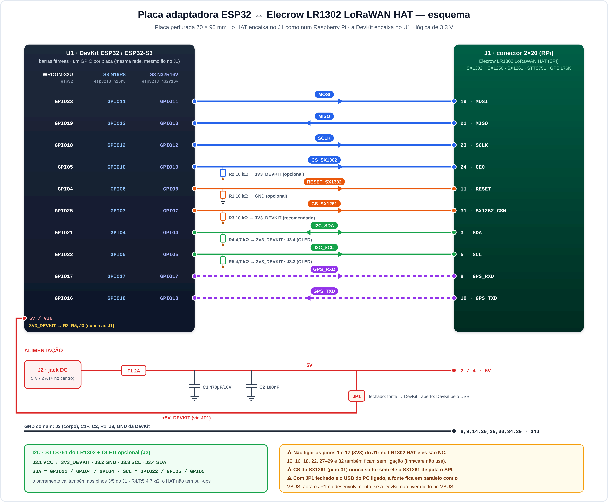
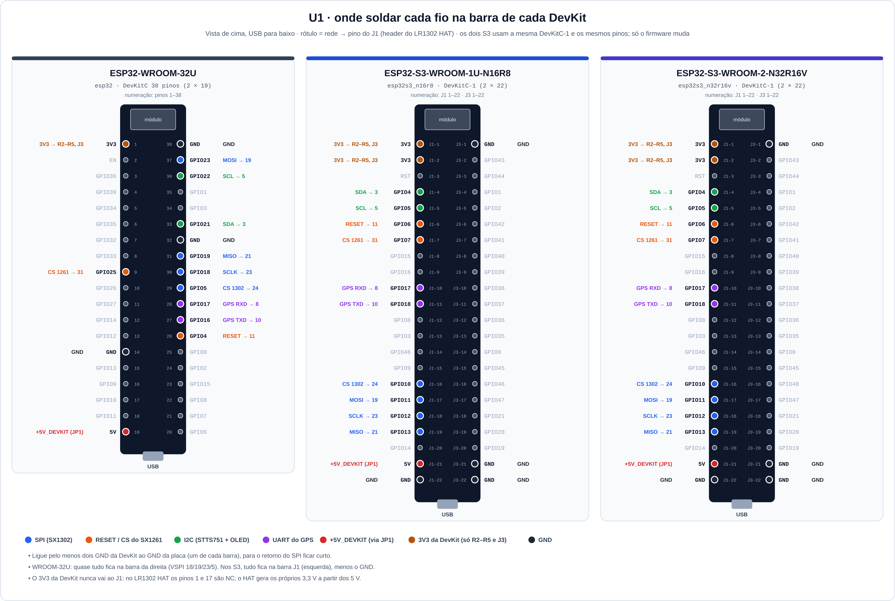
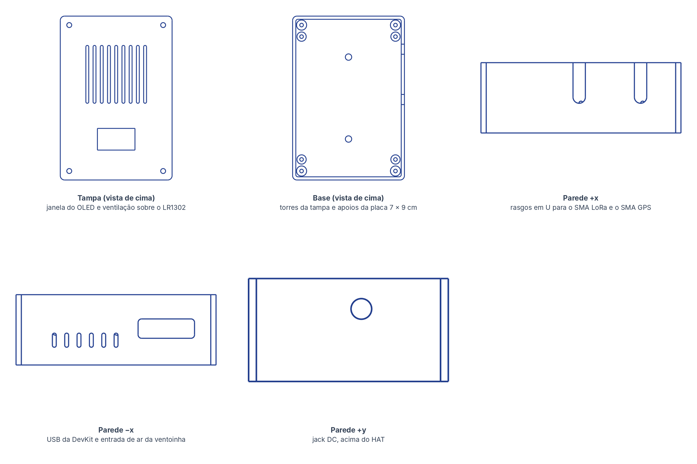

# Hardware Design (ESP32_SX1302)

O hardware do ESP32_SX1302 tem três partes. O concentrador é uma placa pronta, o **Elecrow LR1302 LoRaWAN HAT** (versão SPI), e não um módulo para soldar numa placa-mãe:

| Parte | Pasta |
|---|---|
| Concentrador | [`lr1302_hat/`](lr1302_hat/) (**Elecrow LR1302 HAT**: datasheet, figuras e header de 40 pinos) + [`sx1302/`](sx1302/) (referência Semtech CoreCell e parâmetros que dependem da placa) |
| Placa-mãe | [`motherboard/`](motherboard/): **placa adaptadora em placa perfurada**. O LR1302 HAT encaixa num conector 2×20, como num Raspberry Pi, e a DevKit em barras fêmeas |
| Caixa | [`case/`](case/): **caixa paramétrica** (CadQuery) com STEP, STL e DXF prontos |

A placa adaptadora serve para as **três placas** do projeto, com os mesmos fios até o J1. Só muda o pino da DevKit em que cada fio é soldado:

| `BOARD` | Módulo (DevKit) | Barras do U1 |
|---|---|---|
| `esp32` | **ESP32-WROOM-32U** (DevKitC 38 pinos) | 2 × 19 |
| `esp32s3_n16r8` | **ESP32-S3-WROOM-1U-N16R8** (DevKitC-1) | 2 × 22 |
| `esp32s3_n32r16v` | **ESP32-S3-WROOM-2-N32R16V** (DevKitC-1) | 2 × 22 (mesmos pinos do N16R8) |

```
hardware_design/
├── README.md                     # este arquivo
├── lr1302_hat/
│   ├── README.md                 # resumo do Elecrow LR1302 HAT, medidas e header de 40 pinos
│   └── LR1302_LoRaWAN_Hat_for_RPI_DataSheet.pdf
├── sx1302/
│   └── README.md                 # projeto de referência da Semtech e parâmetros que dependem da placa
├── motherboard/
│   ├── README.md                 # montagem passo a passo
│   ├── esp32_lr1302_adapter_schematic.svg / .png
│   ├── esp32_lr1302_adapter_layout.svg / .png
│   ├── esp32_lr1302_adapter_devkit_pins.svg / .png   # onde soldar em cada uma das 3 DevKits
│   ├── esp32_lr1302_adapter_netlist.csv
│   ├── esp32_lr1302_adapter_bom.csv
│   └── gen_adapter.py, gen_layout.py, gen_devkit_map.py   # geradores (edite e rode de novo)
└── case/
    ├── README.md                 # impressão, parâmetros e o que conferir
    ├── case_sx1302.py            # modelo paramétrico (CadQuery)
    ├── esp32_sx1302_bottom_case.step / .stl
    ├── esp32_sx1302_top_case.step / .stl / .dxf
    └── case_views.png
```

> **A placa adaptadora e a caixa são opcionais.** O gateway funciona com a DevKit ligada ao HAT por 12 jumpers curtos (10 sem o GPS), como nos guias de [`doc/hardware/`](../doc/hardware/). A placa adaptadora e a caixa servem para uma instalação fixa: sem jumpers soltos, com os pull-ups do I2C já na placa e a fonte de 5 V / 2 A num jack próprio.

---

## 1. Concentrador

- **Elecrow LR1302 LoRaWAN HAT (SPI):** placa pronta com o módulo LR1302 (SX1302 + SX1250 + SX1262) num encaixe mini-PCIe, GPS L76K, sensor de temperatura STTS751, ventoinha e header de 40 pinos no padrão Raspberry Pi. Não há nada para fabricar. O datasheet (V1.0, abr/2025) fica em [`lr1302_hat/`](lr1302_hat/), e as figuras dele em [`doc/images/lr1302/`](../doc/images/lr1302/).
- **Projeto de referência da Semtech:** o módulo LR1302 segue o **CoreCell** da Semtech (SX1302 + SX1250). Os valores de `rssi_offset`, `rssi_tcomp` e `tx_gain_lut` dos JSON vêm desse projeto, na versão de 915 MHz. Detalhes: [`sx1302/README.md`](sx1302/README.md).

## 2. Placa adaptadora

<p align="center">
  <a href="motherboard/esp32_lr1302_adapter_schematic.png"></a>
</p>

Ela tem só conectores e passivos:
- **J1**: 2×20 macho, onde o LR1302 HAT encaixa.
- **U1**: barras fêmeas para a DevKit (ESP32-WROOM-32U, ESP32-S3-WROOM-1U-N16R8 ou ESP32-S3-WROOM-2-N32R16V).
- **J2**: jack DC de 5 V, com **F1** (PTC) e **C1/C2** para os picos do TX.
- **JP1**: escolhe se a fonte também alimenta a DevKit.
- **R3**: mantém o CS do SX1262 (pino 31) em nível alto. **R4/R5**: pull-ups do I2C (o HAT não tem).
- **Área livre** embaixo da ventoinha e da CR1220, que ficam na face de baixo do HAT.
- **J3**: OLED opcional, no mesmo I2C do sensor de temperatura.

<p align="center">
  <a href="motherboard/esp32_lr1302_adapter_devkit_pins.png"></a>
</p>

Passo a passo: [`motherboard/README.md`](motherboard/README.md).

## 3. Caixa

<p align="center">
  <a href="case/case_views.png"></a>
</p>

Caixa de 77,4 × 113,4 × 42,2 mm em duas peças (base e tampa) para a placa perfurada de 7 × 9 cm com o LR1302 HAT empilhado. Tem rasgos em U para os dois SMA (LoRa e GPS), abertura para o USB da DevKit, furo para o jack DC acima do HAT, entrada de ar para a ventoinha, janela para o OLED e ventilação sobre o módulo LR1302. **O contorno do HAT é do datasheet; a posição dos SMA foi medida na figura 1 dele (± 1 mm): confira com paquímetro** antes de imprimir ([`case/README.md`](case/README.md)).
