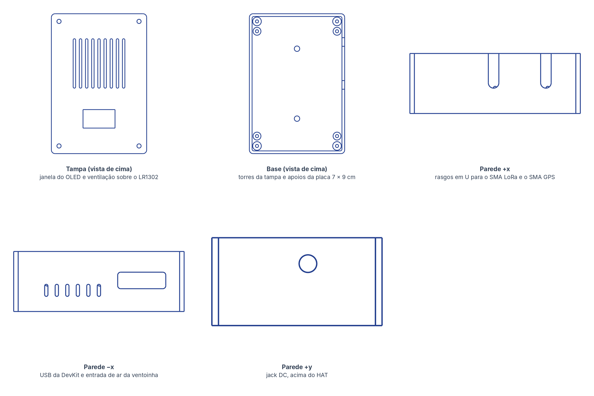

# Caixa do ESP32_SX1302

Caixa em duas peças (base e tampa) para a [placa adaptadora](../motherboard/): placa perfurada de 70 × 90 mm com o LR1302 HAT empilhado a 11 mm e a DevKit ao lado. Serve para as três DevKits do projeto (ESP32-WROOM-32U, ESP32-S3-WROOM-1U-N16R8 e ESP32-S3-WROOM-2-N32R16V).

  

| Arquivo | Uso |
|---|---|
| `esp32_sx1302_bottom_case.stl` / `.step` | base: imprimir de boca para cima |
| `esp32_sx1302_top_case.stl` / `.step` | tampa: imprimir com a face lisa na mesa (a aba para cima) |
| `esp32_sx1302_top_case.dxf` | contorno da tampa para corte a laser (acrílico de 2–3 mm) |
| `case_sx1302.py` | modelo paramétrico em [CadQuery](https://cadquery.readthedocs.io/): `pip install cadquery && python3 case_sx1302.py` gera de novo os arquivos acima |

O `.step` abre no FreeCAD (Arquivo → Importar) e em qualquer CAD.

## Medidas

| Item | Valor |
|---|---|
| Externa | 77,4 × 113,4 × 42,2 mm (base 40 mm + tampa 2,2 mm) |
| Paredes / fundo | 2,2 / 2,0 mm |
| Altura interna | 38 mm: HAT a 11 mm da placa perfurada + módulo LR1302 (a ventoinha fica embaixo do HAT) |
| Placa perfurada | 70 × 90 mm em 4 apoios de 5 mm (M3 autoatarraxante) |
| Tampa | 4 parafusos M3 nas torres dos cantos (furo-piloto de 2,5 mm; use 4,0 mm se for colocar insertos) |
| SMA LoRa / SMA GPS | rasgos em U de 7 mm na parede +x, abertos para cima, centro a 20,4 mm do fundo |
| USB da DevKit | abertura de 32 × 11 mm (cabe os 2 USB-C da S3-DevKitC-1) |
| Jack DC | furo de 8 mm na parede de cima (+y), a 28,2 mm do fundo, acima do HAT (jack 5,5 × 2,1 de painel) |
| Entrada de ar | 6 rasgos na parede −x, entre a placa perfurada e o HAT, para a ventoinha |
| Tampa | janela de 26 × 15 mm para o OLED 0,96" e 9 rasgos de ventilação sobre o módulo LR1302 |

## Conferir antes de imprimir

O contorno do HAT (65 × 57,2 mm) é do [datasheet da Elecrow](../lr1302_hat/LR1302_LoRaWAN_Hat_for_RPI_DataSheet.pdf). A posição dos SMA foi medida na figura 1 do datasheet (± 1 mm), e o resto vem do padrão Raspberry Pi HAT. Meça o seu HAT e ajuste no topo do `case_sx1302.py`:

| Parâmetro | Valor atual | O que medir |
|---|---|---|
| `SMA_Y` | 78,8 e 44,0 mm | centro do SMA LoRa e do SMA GPS ao longo da borda (a partir da borda da placa perfurada do lado da DevKit) |
| `HAT_STACK` | 11 mm | altura do espaçador entre a placa perfurada e o HAT |
| `INNER_H` | 38 mm | altura do módulo LR1302 acima do HAT, com folga |
| `PERF_HOLE_INSET` | 2,5 mm | centro dos furos de canto da sua placa perfurada |
| `USB_Y`, `DC_X` | 16,5 e 30 mm | centro do USB da DevKit (parede −x) e do jack DC (parede +y) |

Dicas:
- **Antenas:** as duas saídas do HAT são SMA. A antena do GPS é ativa (GPS + BeiDou) e precisa de vista para o céu.
- Imprima em **PETG** ou ASA se o gateway ficar em local quente.
- No WROOM-32U e no **ESP32-S3-WROOM-1U (N16R8)**, use uma antena Wi-Fi u.FL com passa-muro na parede. A antena de PCB do **ESP32-S3-WROOM-2 (N32R16V)** funciona através do plástico, mas deixe a ponta do módulo longe de metal.
- A ventoinha do HAT (5 V / 0,08 A) fica embaixo do HAT e puxa ar pelos rasgos da parede −x: não encoste essa parede em nada.
- **Nunca** ligue o HAT sem antena no SMA LoRa.
