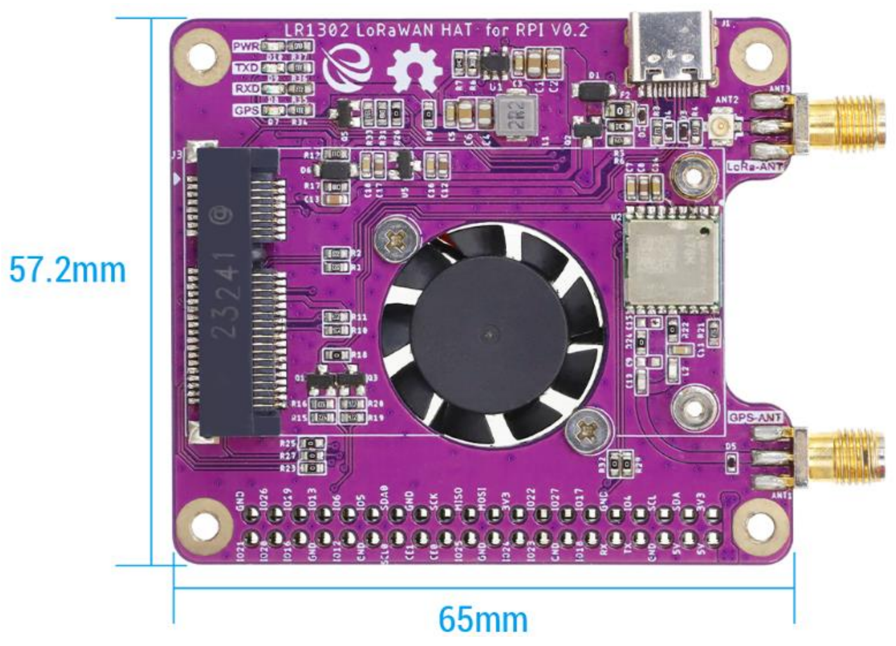
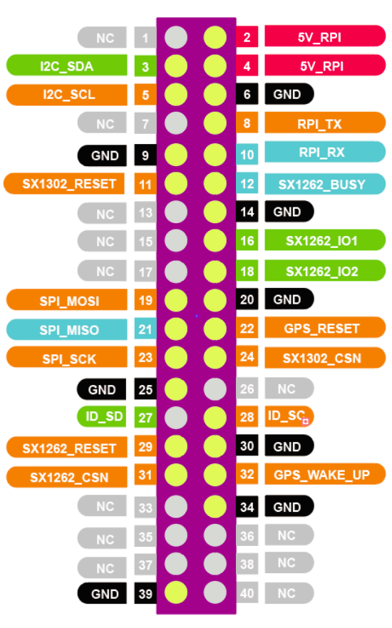

# Elecrow LR1302 LoRaWAN HAT: documentação do fabricante

O concentrador do ESP32_SX1302 é o **Elecrow LR1302 868M/915M LoRaWAN Hat for RPI** (código CRT01265M), na versão **SPI** e na faixa de **915 MHz** (AU915 / US915).

  

- [`LR1302_LoRaWAN_Hat_for_RPI_DataSheet.pdf`](LR1302_LoRaWAN_Hat_for_RPI_DataSheet.pdf): datasheet da Elecrow, V1.0 de 17/04/2025 (16 páginas). Fonte original: <https://elecrow.com/download/product/CRT01265M/LR1302_LoRaWAN_Hat_for_RPI_DataSheet.pdf>.
- Página do produto (esquema e recursos): <https://elecrow.com/wiki/lr1302-lorawan-hat-for-rpi-prd.html>.
- As figuras do datasheet usadas na documentação ficam em [`doc/images/lr1302/`](../../doc/images/lr1302/):

| Figura do datasheet | Arquivo | Conteúdo |
|:---:|---|---|
| 1 | `lr1302_fig1_dimensoes.png` | Vista de cima com as dimensões (65 × 57,2 mm) |
| 2 | `lr1302_fig2_montagem.png` | Montagem com o Raspberry Pi, o módulo LR1302 e as antenas |
| 3 | `lr1302_fig3_blocos.png` | Diagrama de blocos (alimentação, GPS, ventoinha, mini-PCIe) |
| 4 | `lr1302_fig4_interfaces_cima.png` / `_baixo.png` | Interfaces nas duas faces (ventoinha e CR1220 ficam **embaixo**) |
| 5 | `lr1302_fig5_pinagem.png` | Pinagem do header de 40 pinos com a placa |
| — | `lr1302_hat_pinagem_40p.png` | Pinagem do header de 40 pinos (só o conector) |

## Dados que importam para o hardware deste projeto

| Item | Valor (datasheet) | Usado em |
|---|---|---|
| Dimensões | 65 × 57,2 mm, 28 g sem antena; furos no padrão Raspberry Pi HAT (58 × 49 mm) | contorno na [placa adaptadora](../motherboard/) e na [caixa](../case/) |
| Alimentação | 5 V / 1 A, pelo header (pinos 2 e 4) **ou** pelo USB-C (na versão SPI, o USB-C só alimenta). Um DC-DC gera os 3,3 V do HAT | J2/F1/C1 da placa adaptadora (fonte de 5 V / 2 A); o USB-C do HAT fica sem uso |
| Interface | SPI 3,3 V (SX1302 e SX1262) + UART 3,3 V (GPS) + I2C 3,3 V (STTS751) | U1 ↔ J1 sem conversor de nível |
| Módulo | LR1302 (SX1302 + SX1250 + SX1262) em encaixe mini-PCIe de 52 pinos, preso por 2 parafusos | face de cima do HAT |
| Antena LoRa | SMA 50 Ω (LoRa-ANT), ligada ao U.FL do módulo por cabo IPEX-1 | rasgo em U da caixa |
| Antena GPS | SMA 50 Ω (GPS-ANT), para antena ativa GPS + BeiDou | rasgo em U da caixa |
| GPS | L76K (GPS L1, BeiDou B1I, GLONASS L1), < 2,0 m CEP, UART | pinos 8/10 |
| Bateria | CR1220 (3 V) para *hot start* do GPS, **na face de baixo** | área livre na placa adaptadora |
| Ventoinha | 5 V / 0,08 A, ~25 × 25 × 7 mm, **na face de baixo**, conector de 2 vias 1,25 mm | área livre na placa adaptadora; rasgos de ar na caixa |
| LEDs | PWR (verde), TXD (verde), RXD (azul), GPS (verde, pisca com o PPS quando há *fix*) | — |

### Medidas tiradas das figuras

O datasheet só cota o contorno. As posições abaixo foram medidas na figura 1 (vista de cima, header embaixo, SMA à direita), em mm a partir da borda esquerda (x) e da borda do header (y). Têm erro de cerca de 1 mm: confira com paquímetro.

| Item | x | y |
|---|---|---|
| Pino 1 do header (3V3/NC, ponta do lado dos SMA) | 56,6 | 4,8 |
| SMA LoRa (borda direita, sai ~10 mm para fora) | 65 | 46,0 |
| SMA GPS (borda direita) | 65 | 11,2 |
| Ventoinha (face de baixo) | 20,8 a 45,8 | 11,3 a 36,3 |
| Suporte da CR1220 (face de baixo) | 0,5 a 15 | 18 a 39 |
| Parafusos do módulo LR1302 | 54,2 | 16,9 e 41,0 |
| USB-C (borda de cima) | 51,7 | 57,2 |

## Header de 40 pinos

  

| Pino | Nome no HAT | Tipo | Função | Ligado na placa adaptadora |
|:---:|---|:---:|---|:---:|
| 1, 17 | NC (3V3 do RPi) | — | sem ligação no HAT | — |
| 2, 4 | 5V_RPI | alimentação | entrada de 5 V | ✅ +5V |
| 3 | I2C_SDA | DIO | dados do sensor de temperatura (STTS751) | ✅ |
| 5 | I2C_SCL | DI | relógio do sensor de temperatura | ✅ |
| 8 | GPS_RXD (RPI_TX) | DI | RX da UART do GPS | ✅ *(opcional)* |
| 10 | GPS_TXD (RPI_RX) | DO | TX da UART do GPS | ✅ *(opcional)* |
| 11 | RESET | DI | reset do SX1302, **ativo alto na versão SPI** (ativo baixo na USB) | ✅ |
| 12 | SX1262_BUSY | DO | BUSY do SX1262 | — |
| 16, 18 | SX1262_IO1, SX1262_IO2 | DIO | DIO1 e DIO2 do SX1262 | — |
| 19, 21, 23 | SPI_MOSI, SPI_MISO, SPI_SCK | DI / DO / DI | SPI | ✅ |
| 22 | GPS_RST | DI | reset do GPS, ativo baixo | — |
| 24 | SX1302_CSN | DI | CS do SX1302 (CE0) | ✅ |
| 27, 28 | ID_SD, ID_SC | DIO | I2C da EEPROM de ID do HAT | — |
| 29 | SX1262_RST | DI | reset do SX1262 | — |
| 31 | SX1262_CSN | DI | CS do SX1262 | ✅ (fica em nível alto) |
| 32 | GPS_WAKE_UP | DI | nível baixo entra/sai do modo *standby* | — |
| 6, 9, 14, 20, 25, 30, 34, 39 | GND | — | terra | ✅ |
| 7, 13, 15, 26, 33, 35–38, 40 | NC | — | sem ligação no HAT | — |

> **PPS:** o datasheet não traz o PPS do GPS no header; ele só acende o LED "GPS". Por isso o firmware não tem referência de tempo GPS (`"tref":false`). Para usar o PPS, seria preciso tirar o sinal direto do L76K no HAT.
>
> **SX1262 (pinos 12, 16, 18, 29):** o firmware não usa o rádio auxiliar. Ele só mantém o CS (pino 31) em nível alto, para o SX1262 não disputar o SPI com o SX1302.

A figura com o header e o GPIO de cada placa fica em [`doc/images/lr1302_hat_header.png`](../../doc/images/lr1302_hat_header.png), e o guia de ligação direta (jumpers), em [`doc/hardware/`](../../doc/hardware/).
