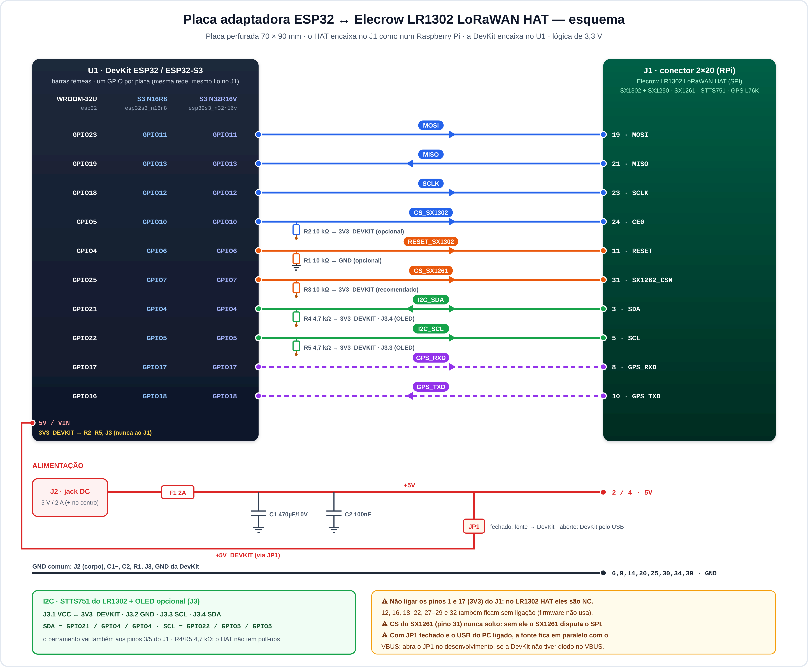
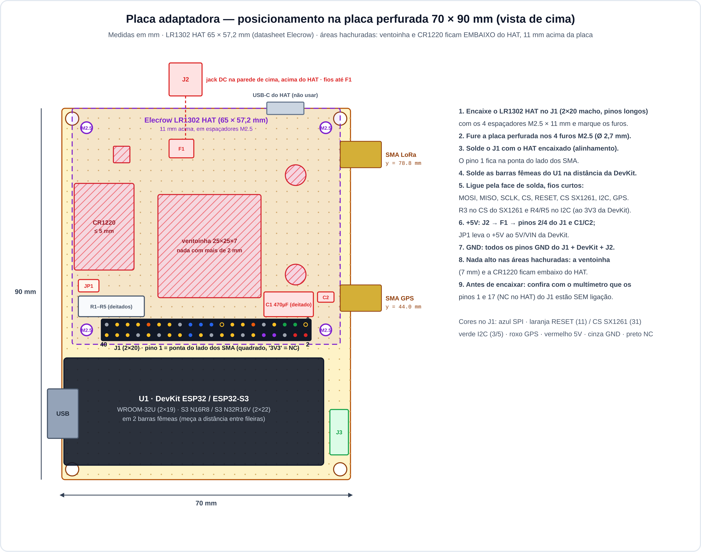
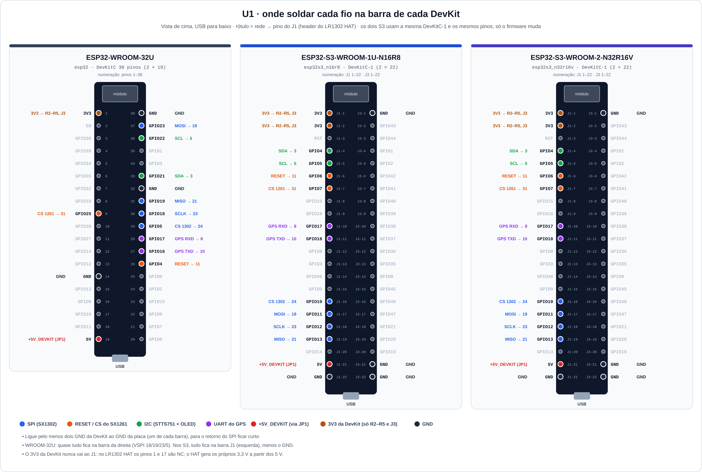

# Placa adaptadora ESP32 ↔ Elecrow LR1302 HAT (placa perfurada 70 × 90 mm)

A placa adaptadora do LR1302 HAT é montada numa placa perfurada (ilhada) comum de 7 × 9 cm. O **HAT encaixa no J1 como num Raspberry Pi**, e a **DevKit encaixa em barras fêmeas**. Os fios ficam curtos na face de solda, os pull-ups do I2C já ficam na placa, e a fonte de 5 V / 2 A entra por um jack próprio.

Serve para as três placas do projeto. Os fios até o J1 são os mesmos; só muda o pino da DevKit em que cada fio é soldado (colunas `esp32`, `esp32s3_n16r8` e `esp32s3_n32r16v` da netlist).

<p align="center">
  <a href="esp32_lr1302_adapter_schematic.png"></a>
</p>
<p align="center"><sub>🔍 Alta resolução (PNG): clique para ampliar · vetorial: <a href="esp32_lr1302_adapter_schematic.svg"><code>esp32_lr1302_adapter_schematic.svg</code></a></sub></p>

<p align="center">
  <a href="esp32_lr1302_adapter_layout.png"></a>
</p>
<p align="center"><sub>🔍 Alta resolução (PNG): clique para ampliar · vetorial: <a href="esp32_lr1302_adapter_layout.svg"><code>esp32_lr1302_adapter_layout.svg</code></a></sub></p>

<p align="center">
  <a href="esp32_lr1302_adapter_devkit_pins.png"></a>
</p>
<p align="center"><sub>🔍 Alta resolução (PNG): clique para ampliar · vetorial: <a href="esp32_lr1302_adapter_devkit_pins.svg"><code>esp32_lr1302_adapter_devkit_pins.svg</code></a></sub></p>

## Arquivos

| Arquivo | Conteúdo |
|---|---|
| [`esp32_lr1302_adapter_schematic.svg`](esp32_lr1302_adapter_schematic.svg) / `.png` | esquema |
| [`esp32_lr1302_adapter_layout.svg`](esp32_lr1302_adapter_layout.svg) / `.png` | posição dos componentes na placa perfurada |
| [`esp32_lr1302_adapter_devkit_pins.svg`](esp32_lr1302_adapter_devkit_pins.svg) / `.png` | onde soldar cada fio na barra de cada uma das três DevKits |
| [`esp32_lr1302_adapter_netlist.csv`](esp32_lr1302_adapter_netlist.csv) | ligação a ligação: rede, pino do J1, GPIO de cada placa |
| [`esp32_lr1302_adapter_bom.csv`](esp32_lr1302_adapter_bom.csv) | lista de materiais |
| `gen_adapter.py`, `gen_layout.py`, `gen_devkit_map.py` | geradores dos arquivos acima |

Para gerar de novo (por exemplo, depois de mudar um pino em `main/CMakeLists.txt` e na tabela `NETS` de `gen_adapter.py`):

```bash
cd hardware_design/motherboard
python3 gen_adapter.py && python3 gen_layout.py && python3 gen_devkit_map.py
for f in esp32_lr1302_adapter_*.svg; do rsvg-convert -w 3800 "$f" -o "${f%.svg}.png"; done
```

## Ligações

A pinagem é a de [`main/CMakeLists.txt`](../../main/CMakeLists.txt), a mesma dos guias de [`doc/hardware/`](../../doc/hardware/). Os pinos do J1 seguem a figura 5 do [datasheet do HAT](../lr1302_hat/LR1302_LoRaWAN_Hat_for_RPI_DataSheet.pdf) ([`lr1302_hat/`](../lr1302_hat/)).

| Rede | J1 (pino RPi) | `esp32` (WROOM-32U) | `esp32s3_n16r8` (WROOM-1U) | `esp32s3_n32r16v` (WROOM-2) |
|---|:---:|:---:|:---:|:---:|
| MOSI | 19 | GPIO23 · pino 37 | GPIO11 · J1-17 | GPIO11 · J1-17 |
| MISO | 21 | GPIO19 · pino 31 | GPIO13 · J1-19 | GPIO13 · J1-19 |
| SCLK | 23 | GPIO18 · pino 30 | GPIO12 · J1-18 | GPIO12 · J1-18 |
| CS do SX1302 | 24 | GPIO5 · pino 29 | GPIO10 · J1-16 | GPIO10 · J1-16 |
| RESET do SX1302 (ativo alto) | 11 | GPIO4 · pino 26 | GPIO6 · J1-6 | GPIO6 · J1-6 |
| CS do SX1261/SX1262 (fica em nível alto) | 31 | GPIO25 · pino 9 | GPIO7 · J1-7 | GPIO7 · J1-7 |
| I2C SDA (STTS751 + OLED) | 3 | GPIO21 · pino 33 | GPIO4 · J1-4 | GPIO4 · J1-4 |
| I2C SCL (STTS751 + OLED) | 5 | GPIO22 · pino 36 | GPIO5 · J1-5 | GPIO5 · J1-5 |
| GPS RXD ← TX do ESP32 *(opcional)* | 8 | GPIO17 · pino 28 | GPIO17 · J1-10 | GPIO17 · J1-10 |
| GPS TXD → RX do ESP32 *(opcional)* | 10 | GPIO16 · pino 27 | GPIO18 · J1-11 | GPIO18 · J1-11 |
| +5V | 2, 4 | 5V · pino 19, pelo JP1 | 5V · J1-21, pelo JP1 | 5V · J1-21, pelo JP1 |
| GND | 6, 9, 14, 20, 25, 30, 34, 39 | GND · pinos 14, 32, 38 | GND · J1-22, J3-1, J3-21, J3-22 | GND · J1-22, J3-1, J3-21, J3-22 |
| 3V3 da DevKit → R2–R5, J3 | — | 3V3 · pino 1 | 3V3 · J1-1 / J1-2 | 3V3 · J1-1 / J1-2 |
| **Pinos 1 e 17 (NC no HAT)** | **não ligar** | — | — | — |
| SX1262: 12 (BUSY), 16/18 (DIO1/DIO2), 29 (RESET) | não ligar | — | — | — |
| GPS: 22 (GPS_RST), 32 (GPS_WAKE_UP) · EEPROM: 27/28 | não ligar | — | — | — |

Numeração dos pinos da DevKit igual à das figuras de pinagem do projeto (vista de cima, USB para baixo): no WROOM-32U, 1–19 na barra da esquerda (de cima para baixo) e 38–20 na da direita; nos S3, J1-1 a J1-22 à esquerda e J3-1 a J3-22 à direita.

> **Os dois S3 usam a mesma DevKitC-1 e os mesmos pinos.** A placa adaptadora é a mesma para o N16R8 e o N32R16V; só o firmware muda (`esp32s3_n16r8` ou `esp32s3_n32r16v`). Confira a marcação do módulo antes de gravar ([`doc/hardware/README.md`](../../doc/hardware/README.md)).

## Área livre embaixo do HAT

A **ventoinha** (~25 × 25 × 7 mm) e o **suporte da CR1220** ficam na face de **baixo** do LR1302 HAT, virados para a placa adaptadora (figura 4 do datasheet). Com espaçadores de 11 mm, sobram só ~2 mm embaixo da ventoinha e ~5 mm embaixo da bateria. O desenho de posicionamento marca essas áreas hachuradas; nelas só passam fios pela face de solda. Os outros componentes ficam assim:

| Componente | Onde fica | Altura |
|---|---|---|
| R1–R5 (deitados), JP1 | à esquerda, entre o J1 e a CR1220 | ≤ 9 mm (JP1 com o jumper) |
| C1 (deitado), C2 | à direita, entre o J1 e o parafuso do módulo | ≤ 9 mm |
| F1 | perto da borda de cima, embaixo do HAT | ≤ 10 mm |
| J2 | **parede de cima da caixa, acima do HAT** (fios até o F1) | — |
| J3 | ao lado da DevKit, fora do HAT | — |

Os parafusos do módulo LR1302 (2 cabeças na face de baixo, à direita) também ficam marcados.

## Montagem

1. **Encaixe o HAT no J1** (barra 2×20 macho de pinos longos, ainda solta) e prenda com os 4 espaçadores M2.5 × 11 mm. Apoie o conjunto na placa perfurada, na posição do desenho, e marque os 4 furos.
2. **Fure** os 4 pontos com broca de 2,7 mm. Os furos da placa perfurada não caem na grade dos furos M2.5 do padrão HAT (58 × 49 mm).
3. **Solde o J1 com o HAT encaixado**, para o alinhamento ficar certo. Com o HAT virado como na figura 1 do datasheet (header embaixo, SMA à direita), o **pino 1 fica na ponta da direita**, do lado dos SMA, na fileira de dentro (serigrafia "3V3"). Depois tire o HAT.
4. **Solde as barras fêmeas do U1** na distância entre fileiras da sua DevKit. Meça com a DevKit encaixada nas barras: a ESP32-WROOM-32U DevKitC tem 2 × 19 pinos, e a ESP32-S3-DevKitC-1 (N16R8 ou N32R16V) tem 2 × 22. O USB fica virado para a borda da placa.
5. **Ligue os sinais** pela face de solda, com fio rígido AWG 26–28, o mais curto possível: MOSI, MISO, SCLK, CS do SX1302, RESET, CS do SX1261, SDA, SCL e GPS. Use a coluna da sua placa na tabela acima ou a figura `esp32_lr1302_adapter_devkit_pins.png`.
6. **Resistores:** R3 (10 kΩ) do CS do SX1261 ao 3V3 da DevKit; R4 e R5 (4,7 kΩ) do SDA e do SCL ao 3V3 da DevKit. R1 e R2 são opcionais.
7. **Alimentação:** jack DC (J2, de painel, fixado na parede de cima da caixa) → F1 → pinos 2 e 4 do J1. Ponha C1 (470 µF) deitado e C2 (100 nF) junto do J1, fora da área da ventoinha. O JP1 leva o +5V ao 5V/VIN da DevKit.
8. **GND:** ligue todos os pinos GND do J1, pelo menos dois GND da DevKit (um de cada barra), o corpo do J2, C1, C2, R1 e J3.
9. **Antes de encaixar as placas**, confira com o multímetro:
   - os pinos 1 e 17 do J1 sem ligação com nada;
   - nenhum curto entre +5V e GND, nem entre +5V e o 3V3 da DevKit;
   - continuidade de cada sinal da tabela.

## Jumper

| Jumper | Posição | Efeito |
|---|---|---|
| JP1 | fechado | a fonte de 5 V alimenta o HAT **e** a DevKit (uso fixo, sem o USB do PC) |
| JP1 | aberto | a DevKit é alimentada pelo USB do PC, e o HAT pela fonte (desenvolvimento). O GND continua comum |

> ⚠️ Com o **JP1 fechado e o USB do PC ligado**, a fonte de 5 V fica em paralelo com o VBUS do PC. Isso só é seguro se a sua DevKit tiver diodo entre o USB e o pino 5V (confira no esquema dela). Na dúvida, abra o JP1 sempre que ligar o USB.
>
> O LR1302 HAT também tem um USB-C próprio de alimentação. Com a placa adaptadora, **não ligue** esse USB-C: o HAT já recebe 5 V pelos pinos 2 e 4.

## Resistores

| Ref | Valor | Liga | Por quê |
|---|---|---|---|
| R1 | 10 kΩ | RESET do SX1302 → GND | *opcional*: mantém o SX1302 fora de reset enquanto o ESP32 inicia e os GPIOs ainda estão flutuando. O firmware gera o pulso de reset sozinho |
| R2 | 10 kΩ | CS do SX1302 → 3V3 | *opcional*: CS em nível alto no boot |
| R3 | 10 kΩ | CS do SX1261/SX1262 (pino 31) → 3V3 | **recomendado**: o rádio auxiliar (SX1262 no LR1302) fica desligado do SPI também durante o boot. O firmware põe esse pino em nível alto antes do reset do SX1302 |
| R4, R5 | 4,7 kΩ | SDA e SCL → 3V3 | **recomendado**: o HAT não tem pull-ups no I2C (no Raspberry Pi eles ficam na placa do Pi), e os internos do ESP32 (~45 kΩ) podem não bastar para o STTS751 responder |

## Opcional: OLED (J3)

**J3** recebe um OLED SSD1306 0,96" I2C, no mesmo barramento do STTS751 (endereços diferentes: 0x3C no OLED, 0x38–0x3B / 0x48–0x4B no sensor). Alimente pelo 3V3 da DevKit, **nunca** pelos pinos 1/17 do J1.
